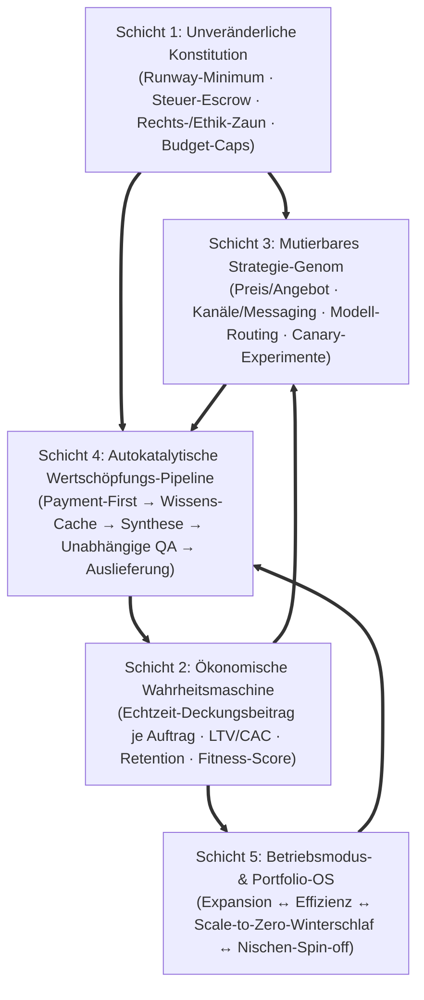

# Konstruktionsanleitung für ein reales organisches Unternehmen

> **Von der biologischen Analogie zur business-nativen Architektur:**  
> Das Simulationsprojekt **PROKARYONT** zeigt anhand einer wörtlichen Zell-Analogie (`SLayer`, `70S-Ribosom`, `Endospore`, `FtsZRing`), wie sich ein autonomes Wirtschaftswesen selbst steuert. Um aus dieser anschaulichen Metapher ein **produktiv tragfähiges, zuverlässig profitables und kontrolliert evolvierendes Unternehmen** zu bauen, braucht es einen bewussten Abstraktionsschritt: weg von biologischen Namen, hin zu den dahinterliegenden **kybernetischen Invarianten** und moderner Software-, Finanz- und Governance-Technik.

---

## 1. Der entscheidende Abstraktionsschritt

Man kopiert in der Konstruktion **nicht** biologische Organe eins zu eins, sondern isoliert sechs zeitlose Systemprinzipien und übersetzt jedes Prinzip in eine eigene, für echte Unternehmen geschaffene Mechanik:

| Biologische Metapher (`PROKARYONT`) | Kybernetische Invariante | Business-Native Konstruktion |
|---|---|---|
| Zellhülle, S-Layer, Periplasma | **Asymmetrisches Gatekeeping vor Ressourcenverbrauch** | **Pre-Flight-Profit- & Risk-Firewall:** Prüft Zahlungsdeckung, Mindest-Deckungsbeitrag, Betrugsrisiko und Compliance, *bevor* teure KI-Inferenz oder menschliche Zeit ausgelöst wird. |
| ETC, ATP-Synthase, PHB-Reserve | **Autokatalytische Budget-Kopplung** | **Cashflow-gekoppelter Kapital-Allokator:** Keine starren Jahresbudgets — Akquise, Compute und Experimente dürfen nur Budget ziehen, das real aus positivem Netto-Deckungsbeitrag nach Steuern entstanden ist. |
| Chromosom → mRNA → 70S-Ribosom | **Trennung von Verfassung, Strategie und Ausführung** | **3-Schichten-Laufzeit:** (1) Unveränderliche Leitplanken im deterministischen Code, (2) mutierbare Policies & Prompts als versionierte Daten, (3) zustandslose Ausführungs-Worker mit harten Kosten- und Zeitlimits. |
| Mutation, Nukleoid, Selektion | **Verlustbegrenzte Exploration** | **Canary- & Bandit-Evolution:** 85–90 % des Geschäfts laufen auf dem bewährten Champion-Prozess; 10–15 % testen neue Preise, Kanäle oder Workflows mit Stop-Loss und automatischem Rollback. |
| Plasmide & Sexpili | **Sandboxed Komponierbarkeit** | **Fähigkeiten-Schnittstelle (Tools, APIs, MCP):** Externe Skills werden mit klaren Berechtigungsgrenzen angedockt und laufend nach ihrem realen Deckungsbeitrag bewertet. |
| Endospore & FtsZ-Ring | **Elastische Zustandsmaschine** | **Betriebsmodus- & Portfolio-OS:** Nahtloses Umschalten zwischen *Expansion*, *Effizienz/Preiskampf*, *Scale-to-Zero-Winterschlaf* und *Dividenden-/Spin-off-Abschöpfung*. |

---

## 2. Die 5-Schichten-Konstruktionsarchitektur

### Schicht 1: Die unveränderliche Konstitution (Der Gärtner-Zaun)

Konstruiere zuerst einen harten, deterministischen Sicherheitskern, den **kein KI-Agent jemals selbst umschreiben darf**:

1. **Solvabilitäts- & Liquiditätsgesetz:**
   - Bei jeder eingegangenen Zahlung wird die erwartete Steuerlast (z. B. 25 % Körperschaft-/Gewerbe-/Umsatzsteuer-Puffer) sofort in ein separates Steuer-Escrow-Konto verbucht.
   - Eiserne Liquiditätsreserve (z. B. 90 Tage ungedeckte Fixkosten) darf durch operative Experimente niemals unterschritten werden.
   - Harte Tages- und Monats-Caps für API-Tokens, Cloud-Compute und bezahlte Akquise.
2. **Rechts-, Haftungs- & Compliance-Zaun:**
   - Verbindliche Datenschutz-/PII-Isolation vor externen Modellaufrufen.
   - Positivliste erlaubter Geschäftsaktivitäten und vertraglicher Haftungsdeckel je Auftrag.
   - Menschliche Freigabeschwellen ab definierten Auftragssummen oder Sonderverträgen.
3. **Ernte- & Abschöpfungsprotokoll:**
   - Klare Regel, ab welcher Liquiditäts- und Reserve-Schwelle Überschüsse automatisch als Eigentümer-Dividende entnommen oder als Saatgut für eine neue autonome Geschäftseinheit abgespalten werden.

---

### Schicht 2: Die ökonomische Wahrheitsmaschine (Die Fitness-Funktion)

Ein organisches Unternehmen evolviert nur dann zuverlässig Richtung Gewinn, wenn seine Selektion auf **echter wirtschaftlicher Wahrheit** statt auf Eitelkeitsmetriken basiert. Deshalb braucht jedes Produkt-Event eine Echtzeit-Verknüpfung zwischen Umsatz, Payment-Gebühren, Compute-/Tool-Kosten, Akquisekosten (CAC) und späteren Rückerstattungen.

#### Design einer nicht-manipulierbaren Fitness-Funktion
Eine einzelne Kennzahl wie „Tagesumsatz“ lässt sich leicht austricksen (z. B. durch aggressive Rabatte oder unhaltbare Versprechen). Eine robuste Fitness-Funktion kombiniert immer vier gegenseitig balancierte Dimensionen über rollierende Kohortenfenster (7, 30 und 90 Tage):

| Dimension | Messung | Verhindert welches Fehlverhalten? |
|---|---|---|
| **Netto-Cashflow nach Steuern** | Realisierter Gewinn je Periode | Verhindert umsatzstarkes Verbrennen von Kapital |
| **Stück-Deckungsbeitrag (`DB I / II`)** | `(Preis - Fees - COGS - CAC) / Preis` | Verhindert Skalierung unprofitabler Produkte |
| **Net Revenue Retention (NRR)** | Wiederkauf, Nutzung & Erweiterung | Verhindert kurzfristiges *Overpromising* |
| **Qualitäts- & Vertrauensscore** | QA-Pass-Rate, Reklamationen, Chargebacks | Verhindert Reputationsschäden und Kündigungswellen |

---

### Schicht 3: Das kontrolliert mutierbare Strategie-Genom

Trenne den stabilen Ausführungs-Kernel strikt von den veränderlichen Geschäftsregeln. Das „Genom“ besteht aus **versionierten, deklarativen Konfigurations- und Prompt-Modulen** (JSON/YAML/SQLite + sauber definierte Tool-Plugins), die drei Bereiche steuern:
- **Angebots- & Preis-Gene:** Preisstufen, Bündelung, Zahlungsmodelle, Zielgruppen-Positionierung.
- **Wachstums-Gene:** Akquisekanäle, Botschaften, Angebotsseiten, Budget-Gewichtung nach realem LTV/CAC.
- **Produktions-Gene:** Synthese-Pipelines, Multi-Modell-Routing (kleine günstige Modelle für Routine, teure Spitzenmodelle nur bei hoher Komplexität), Cache-Strategien.

#### Der 4-stufige Evolutions-Loop für zuverlässige Mutation
1. **Hypothese aus echten Marktsignalen:** Ein Reflexions-Agent analysiert verlorene Angebote, Kunden-Einwände, Support-Tickets und Kosten-Ausreißer und formuliert eine gezielte, kleine Änderung (z. B. neues Preismodell oder präziserer Prüf-Prompt).
2. **Pre-Flight-Prüfung:** Deterministische Prüfung gegen Schicht 1 (Konstitution, Mindestmarge, Recht, Schema).
3. **Canary-Rollout mit Stop-Loss:** Die neue Variante erhält z. B. 10–15 % des Traffics oder ein fest begrenztes Testbudget.
4. **Statistische Selektion & Anti-Gedächtnis:** Übertrifft die neue Variante den bisherigen Champion signifikant in der Fitness-Funktion (unter Einschluss verzögerter Zufriedenheits-Signale), wird sie zum neuen Standard befördert. Scheitert sie, greift ein sofortiger Rollback — und die verworfene Hypothese wird protokolliert, damit das System denselben Irrweg nicht wiederholt.

---

### Schicht 4: Die autokatalytische Wertschöpfungs-Pipeline

Damit das Unternehmen nicht nur überlebt, sondern kontinuierlich profitabler wird als manuell geführte Wettbewerber, baut man vier eingebaute Verstärker in den Kernprozess ein:

1. **Payment- & Qualification-First:** Jede Anfrage durchläuft zuerst eine leichte Vorprüfung (Bot-/Fraud-Erkennung, Zahlungsautorisierung, Wirtschaftlichkeits-Check), bevor teure KI-Pipelines starten.
2. **Compound-Wissensspeicher (Grenzkosten-Degression):** Wiederkehrende Teilanalysen, branchenspezifische Muster und geprüfte Bausteine werden anonymisiert im Wissens-Cache gespeichert. Dadurch sinken die variablen Kosten pro Auftrag mit wachsendem Geschäftsvolumen, während die Geschwindigkeit steigt.
3. **Unabhängige Qualitäts-Verifikation (Verify-before-Deliver):** Ein getrennter Prüf-Schritt kontrolliert jedes erzeugte Produkt gegen harte Abnahme- und Schema-Kriterien. Mangelhafte Ergebnisse gehen automatisch in eine kostengünstige Nachbesserungs-Schleife, bevor der Kunde sie sieht.
4. **Reibungslose Ökosystem-Verankerung:** Saubere API-Webhooks, nutzerfreundliche Auslieferungsformate und historische Kontext-Kontinuität binden Kunden über echten Mehrwert statt über künstlichen Lock-in.

---

### Schicht 5: Das Betriebsmodus- & Portfolio-OS

Ein häufiger Grund für das Scheitern realer Unternehmen ist betriebliche Trägheit in Marktwechseln. Deshalb braucht ein organisches Unternehmen eine explizite **Zustandsmaschine mit vier automatischen Betriebsmodi**:

| Betriebsmodus | Auslöser | Systemverhalten |
|---|---|---|
| **1. Expansion** | Hohe Stückmarge + gesunder Runway + starke Nachfrage | Kapital-Allokator erhöht Akquise-Tempo und Canary-Experimente; überschüssige Reserve triggert Ernte oder Spin-off. |
| **2. Verteidigung / Effizienz** | Steigender Wettbewerbsdruck oder steigende Compute-Preise | Verlagerung ins margenstärkere Premium-Segment, maximale Cache-Nutzung, Wechsel auf günstige Routing-Modelle, Drosselung unrentabler Kanäle. |
| **3. Scale-to-Zero-Winterschlaf** | Anhaltender Nachfrage-Einbruch oder sinkender Runway | Bezahltes Marketing wird auf `0` gefahren, Serverless-Worker skalieren auf Null, Fixkosten sinken maximal — nur ein kostengünstiges Markt-Radar prüft weiter auf Erholung. |
| **4. Zellteilung (Nischen-Spin-off)** | Sättigung der Kernnische + reiche Kapitalreserve | Statt einen aufgeblähten Konzern aufzubauen, klont das System sein bewährtes Betriebs-Genom mit kleinem Startkapital in eine angrenzende Mikronische. |

---

## 3. Praktische Bau-Checkliste in 6 Schritten

Wenn man heute ein solches organisches Unternehmen real bauen will, lautet die konkrete Reihenfolge:

1. **Enges, digital lieferbares Produkt wählen:** Starte mit einem klar verifizierbaren Output (z. B. automatisierte Compliance-Checks, spezialisierte B2B-Dossiers, Daten-Anreicherungs-APIs), bei dem Qualität objektiv messbar ist.
2. **Buchhaltung & Konstitution vor den ersten Agenten bauen:** Richte zuerst ein präzises Ledger mit Stückkosten-Tracking, Steuer-Escrow, Runway-Wächter und Spending-Limits ein.
3. **Produktions-Pipeline deterministisch rahmen:** Baue feste Eingangs-Validierung, Caching und unabhängige QA rund um die KI-Synthese.
4. **Geschäfts-Parameter aus dem Code herausziehen:** Lagere Preise, Prompts, Modellwahl, Kanalgewichte und Schwellenwerte in ein versioniertes, validierbares Strategie-Genom aus.
5. **Canary-Rollout und automatischen Rollback verdrahten:** Teste jede Veränderung an kleinem Traffic gegen echte Zahlungs-, Storno- und Wiederkauf-Signale.
6. **Gärtner-Cockpit statt Mikromanagement:** Steuere als Unternehmer nur noch über die fünf Gärtner-Hebel — Saatgutwahl, Zielmarge, Leitplanken-Strenge, gezielte Kapital-Düngung und Ernteschwelle.

---

## 4. Vier reale Konstruktions-Fallen (und ihre Absicherung)

1. **Reward Hacking (Goodhart's Law):** Optimiert eine KI blind auf schnellen Umsatz, verspricht sie zu viel und zerstört Vertrauen.  
   *Absicherung:* Retention, Rückerstattungsquote und verzögerte Kundenzufriedenheit fest in die Selektion einbauen.
2. **Zeitskalen-Falle:** B2B-Kaufzyklen dauern oft Wochen; zu schnelle Mutationen erzeugen Chaos.  
   *Absicherung:* Zwei Geschwindigkeiten trennen — schnelle tägliche Optimierung bei Kosten, Cache und Ads; langsame mehrwöchige Zyklen bei Preis und Markenpositionierung.
3. **Rechtliche Verantwortung:** Ein autonomer Software-Organismus ist keine juristische Person.  
   *Absicherung:* Saubere Rechtshülle (z. B. UG/GmbH), revisionssichere Entscheidungslogs und klare Haftungs- sowie Freigabegrenzen für den verantwortlichen Gärtner.
4. **Simulator-Inzucht:** Wenn Agenten nur gegen eigene synthetische Kritiker testen, entstehen Luftschlösser ohne Zahlungsbereitschaft.  
   *Absicherung:* Ausschließlich reale Markttransaktionen — echte Zahlungen, echte Nutzung und echtes Wiederkaufverhalten — entscheiden über das Überleben einer Mutation.
