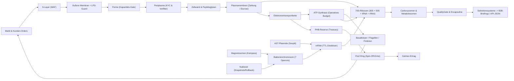
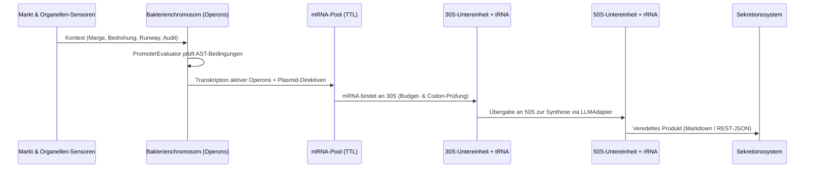
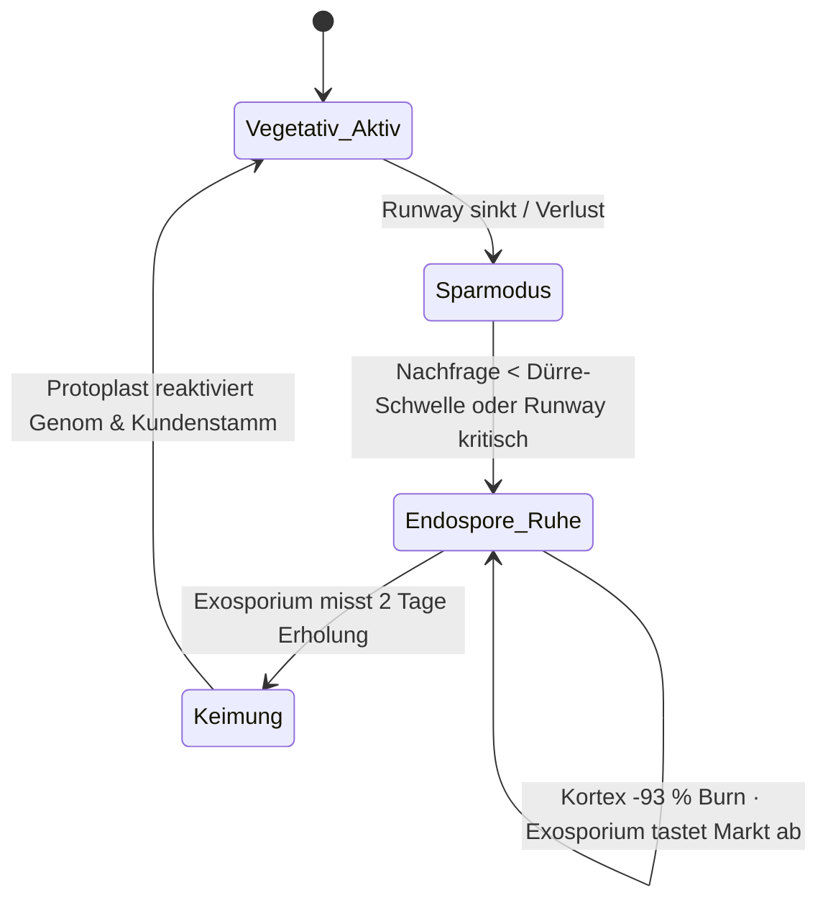
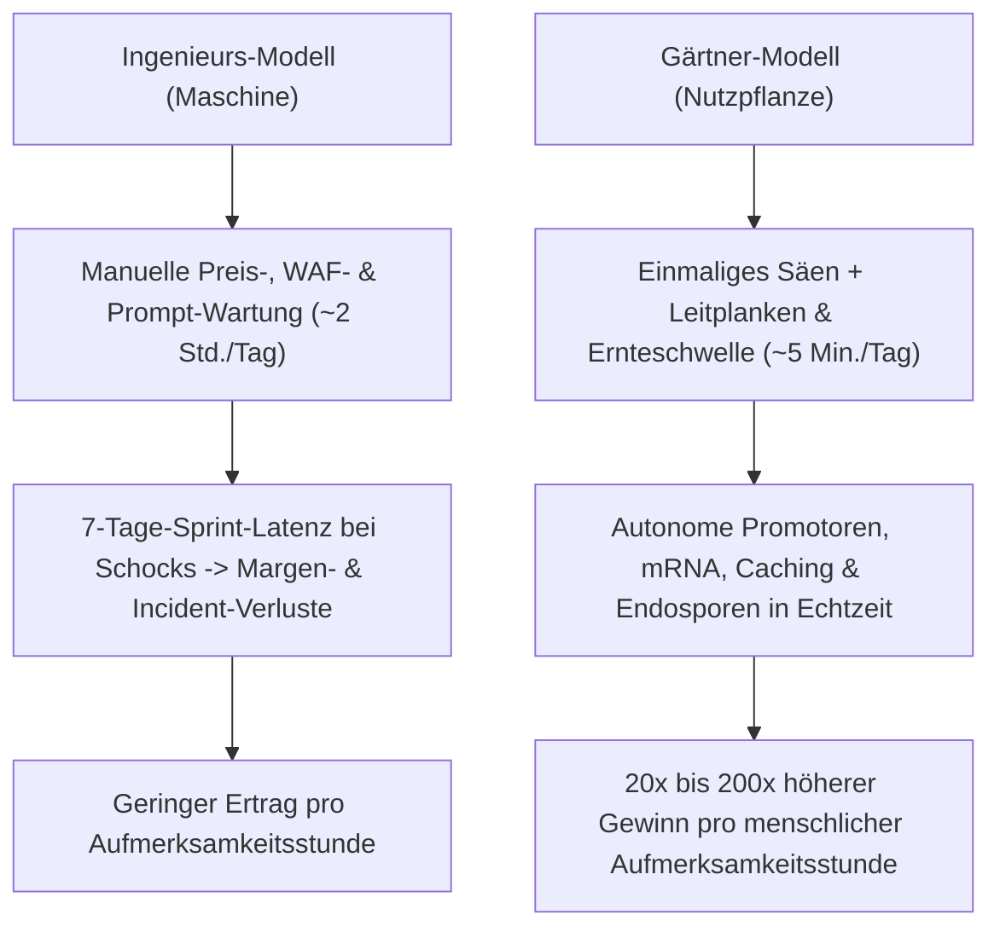

# PROKARYONT — Architektur- & Bio-Ökonomie-Handbuch

> **Vom Maschinen-Ingenieur zum Nutzpflanzen-Gärtner:**  
> Wie aus dem Bauplan der einfachsten biologischen Zelle (Prokaryont) ein sich selbst regulierender, adaptiver und hochrentabler digitaler Wirtschaftsorganismus entsteht.

---

## 1. Leitidee & Biologisch-Ökonomische Kausalarchitektur

Ein klassisches Software-Unternehmen oder eine herkömmliche Automatisierungspipeline gleicht einer **Maschine**: Jede Preisänderung, jeder Schutzfilter, jedes Fallback-Routing und jede Krisendrosselung muss vom Menschen entworfen, überwacht und gewartet werden.

Ein **biologischer Prokaryont** existiert seit 3,8 Milliarden Jahren ohne Operator, weil sämtliche Lebensprozesse in geschlossenen kausalen Regelkreisen miteinander verdrahtet sind:

- **Nahrungsaufnahme → Umsatz:** Eingehende Marktanfragen durchlaufen selektive Kanäle (`Porine`), werden vor dem teuren Compute validiert (`Periplasma`) und an der `Plasmamembran` in reale Zahlungen umgewandelt.
- **Innerer Stoffwechsel → Produkt-Output:** Die `Elektronentransportkette` verwandelt reale Netto-Erlöse in einen Überschussgradienten, der über die `ATP-Synthase` operatives Budget erzeugt. Das `70S-Ribosom` (`30S` + `50S` + `tRNA` + `rRNA`) synthetisiert mithilfe von `Glykogen-Cache`, `Carboxysomen` und `Metabolosomen` konkrete B2B-Briefings oder API-Payloads und exportiert sie über `Sekretionssysteme`.
- **Adaptive DNA → Kausale Prozesssteuerung:** Das `Bakterienchromosom` im geschützten `Nukleoid` bewertet laufend Promotoren, transkribiert `mRNA`-Pläne, reguliert alle Organellen kausal und evolviert über eine Fitness-selektierte `MutationEngine` mit automatischem Rollback. Ergänzt wird es durch sandboxed ausführbare `CodePlasmide`, die über `Sexpili` gehandelt werden.
- **Nutzpflanze & Gärtner:** Die Zelle schüttet Überschüsse aus der `PHB-Reserve` über den `FtsZ-Ring` als Ernte an den Gärtner aus und schützt sich in Rezessionen selbstständig per `Endospore` (`Kortex` senkt Fixkosten um ~93 %).

---

## 2. Kausal-Diagramme (Mermaid)

### 2.1 Gesamtsystem & geschlossene Regelkreise



### 2.2 Kausale Genexpression (DNA → mRNA → 70S-Ribosom → Produkt)



### 2.3 Endosporen-Überlebenszyklus bei Marktdürre



### 2.4 Der Paradigmenwechsel: Ingenieur vs. Gärtner



---

## 3. Vollständige 57-Strukturen-Bewertungsmatrix + 7 Viability-Module

Alle 57 genannten Prokaryonten-Strukturen wurden einer strengen ökonomischen Wert-Prüfung unterzogen:
- **53 Strukturen** (`37` Core-Module + `16` Sub-Module) liefern direkten wirtschaftlichen Wert und sind kausal im Code (`src/prokaryont/`) implementiert.
- **4 Strukturen** (`3` gemergt + `1` ausgeschlossen) sind rein biologische Doppelungen ohne zusätzlichen ökonomischen Nutzen und werden begründet gemergt bzw. ausgeschlossen.
- **7 Viability-Module** ergänzen kaufmännische Notwendigkeiten (Doppelte Buchführung, Elastizitäts-Pricing, SLA-Gate, Kohorten/LTV, Runway-Wächter, Compliance, Gärtner-Benchmark).

| # | Struktur (DE) | System | Status | Python-Symbol | Ökonomische Kausal-Funktion / Begründung |
|---|---|---|---|---|---|
| 1 | S-Layer | envelope | active | `SLayer` | Kristalline Edge-WAF & Bot-/DDoS-Filter vor Compute-Kosten |
| 2 | äußere Membran | envelope | active | `OuterMembrane` | Public Edge / DMZ zwischen Markt und Periplasma |
| 3 | Lipopolysaccharide | envelope | submodule | `LipopolysaccharideGuard` | Fraud-, Chargeback- & Injection-Erkennung |
| 4 | Porine | envelope | active | `PorinChannel` | Selektive API-/Order-Kanäle mit dynamischer ATP-Apertur |
| 5 | Periplasma | envelope | active | `Periplasm` | Pre-Processing, KYC & Profitabilitäts-Vorfilter |
| 6 | Zellwand | envelope | active | `CellWall` | Strukturgrenze gegen finanzielle Überschuldung (Lyse) |
| 7 | Peptidoglykan-Schicht | envelope | submodule | `PeptidoglycanLayer` | Quervernetzte Policy-, Escrow- & Budget-Matrix |
| 8 | Pseudopeptidoglykan-Schicht | envelope | **merged** | → `PeptidoglycanLayer` | Archaeales Äquivalent ohne ökonomischen Zusatzwert |
| 9 | Plasmamembran | envelope | active | `PlasmaMembrane` | Zahlungsabwicklung (`PaymentAdapter`) & ETC-Anker |
| 10 | Glykokalyx | envelope | active | `Glycocalyx` | Marken- & Kundenbindungs-Schutzschicht |
| 11 | Kapsel | envelope | submodule | `Capsule` | Markenstärke & SLA-Siegel für Preis-Premium |
| 12 | Schleimschicht | envelope | submodule | `SlimeLayer` | Kundenkontext-Stickiness & Wiederkaufrate |
| 13 | Cytoplasma | cytoskeleton | active | `Cytoplasm` | Gesamte interne Agenten-Laufzeitumgebung |
| 14 | Cytosol | cytoskeleton | submodule | `Cytosol` | In-Memory-Event-Bus & Working-Memory |
| 15 | Zytoskelett-Homologe | cytoskeleton | active | `Cytoskeleton` | Container für Skalierung & Spin-Off-Ernte |
| 16 | FtsZ-Ring | cytoskeleton | active | `FtsZRing` | Kontraktionsring zur Gewinn-Ernte an den Gärtner |
| 17 | MreB-Filamente | cytoskeleton | active | `MreBFilaments` | Dynamischer Kapazitäts- & Worker-Load-Balancer |
| 18 | Crescentin | cytoskeleton | **excluded** | `None` | Rein geometrische Zellkrümmung ohne Ertragswert |
| 19 | Nukleoid | genetics | active | `Nucleoid` | Genom-Vault mit Snapshots, Rollback & Leitplanken |
| 20 | Bakterienchromosom | genetics | active | `BacterialChromosome` | 7 ausführbare Operons mit AST-Promotoren |
| 21 | Plasmide | genetics | active | `PlasmidRegistry` | AST-sandboxed ausführbare Python-Erweiterungsmodule |
| 22 | mRNA | genetics | active | `MessengerRNA` | Kurzlebige Ausführungs-Direktiven mit TTL-Zerfall |
| 23 | 70S-Ribosomen | genetics | active | `Ribosome70S` | Kausale Produktions- und Synthesefabrik |
| 24 | 30S-Untereinheit | genetics | submodule | `Subunit30S` | mRNA-Decoder, Budgetprüfung & tRNA-Bindung |
| 25 | 50S-Untereinheit | genetics | submodule | `Subunit50S` | Katalytische Produkt-Synthese (`LLMAdapter`) |
| 26 | tRNA | genetics | active | `TransferRNA` | Typisierte Skill-, Prompt- & Schema-Adapter |
| 27 | rRNA | genetics | submodule | `RibosomalRNA` | Strukturelle Format- & Schema-Fidelität |
| 28 | Flagellen | motility | active | `FlagellumSystem` | Chemotaxis-Marktnavigation in rentable Nischen |
| 29 | Basalkörper | motility | submodule | `BasalBody` | ATP-getriebener Marketing-Budget-Motor |
| 30 | Haken | motility | submodule | `FlagellarHook` | Kanal-Kupplung für Vertriebskanäle |
| 31 | Flagellenfilament | motility | submodule | `FlagellarFilament` | Outbound-Reichweiten-Propeller |
| 32 | Archaellen | motility | **merged** | → `FlagellumSystem` | Archaeale Motilitäts-Doppelung neben ATP-Flagellum |
| 33 | Fimbrien | motility | active | `Fimbriae` | Lead-Capture-Hooks, Free-Tools & Viral-Schleifen |
| 34 | Pili | motility | active | `Pili` | Stabile B2B-Partner-, CRM- & API-Verankerungen |
| 35 | Sexpili | motility | active | `SexPili` | Horizontaler Plasmid-Handel & Lizenz-Erlöse |
| 36 | Elektronentransportkette | metabolism | active | `ElectronTransportChain` | Umsatz-zu-Netto-Margen-Wertschöpfungskette |
| 37 | ATP-Synthase | metabolism | active | `ATPSynthase` | Wandelt Netto-Marge in operatives ATP-Budget |
| 38 | Thylakoide | metabolism | active | `Thylakoids` | Passive organische Inbound-Flächen (SEO/Kataloge) |
| 39 | Phycobilisomen | metabolism | submodule | `Phycobilisomes` | Hochsensitive Long-Tail-/Nischen-Antennen |
| 40 | Chlorosomen | metabolism | **merged** | → `Phycobilisomes` | Schwachlicht-Doppelung, als Modus integriert |
| 41 | Bakterien-Mikrokompartimente | metabolism | active | `MicrocompartmentFramework` | Isolierte Ausführungs-Kammern für Kernprozesse |
| 42 | Carboxysomen | metabolism | active | `Carboxysomes` | Wertkonzentrations-Kammer für hohe Token-Effizienz |
| 43 | Metabolosomen | metabolism | active | `Metabolosomes` | Fehler-Retry & Multi-Modell-Kosten-Arbitrage |
| 44 | Encapsuline | metabolism | active | `Encapsulins` | Verschlüsselter Secret-, PII- & Audit-Tresor |
| 45 | Magnetosomen | metabolism | active | `Magnetosomes` | EMA-Makro-Trendkompass gegen Marktrauschen |
| 46 | Gasvesikel | metabolism | active | `GasVesicles` | Dynamischer Auftrieb zwischen Volumen & Premium |
| 47 | Einschlusskörperchen | storage | active | `InclusionBodies` | Strategischer Container aller 4 Reserve-Speicher |
| 48 | Polyhydroxybutyrat-Granula | storage | active | `PHBReserve` | Langfristige Liquiditäts- & Ernte-Reserve |
| 49 | Glykogen-Granula | storage | active | `GlycogenCache` | Semantischer Output-Cache (-COGS) |
| 50 | Volutin-Granula | storage | active | `VolutinPool` | Vorausbezahlte Compute-Kontingente gegen Preisschocks |
| 51 | Schwefel-Globuli | storage | active | `SulfurBuffer` | Kuratierter Rohdaten-, Benchmark- & Warm-Lead-Vorrat |
| 52 | Endosporen | dormancy | active | `EndosporeSystem` | Autonomes Krisen-Ruhestadium bei Rezession |
| 53 | Exosporium | dormancy | submodule | `Exosporium` | Minimal-Heartbeat-Sensor zur Keimungs-Erkennung |
| 54 | Sporenmantel | dormancy | submodule | `SporeCoat` | SHA-256-Snapshot & JSON-Saatgut-Export |
| 55 | Kortex | dormancy | submodule | `SporeCortex` | Fixkosten-Dehydrierung um ~93 % |
| 56 | Protoplast | dormancy | submodule | `SporeProtoplast` | Versiegelter Minimal-Kern (Genom, Plasmide, PHB) |
| 57 | Sekretionssysteme | secretion | active | `SecretionSystem` | Multi-Protokoll-Export (Markdown-Briefing & REST-JSON) |

### Ergänzende Viability-Module (`src/prokaryont/viability/`)
1. `PricingEngine` (`pricing_engine`) — Elastizitäts- & Zielmargen-Steuerung
2. `DoubleEntryLedger` (`double_entry_ledger`) — Doppelte Buchführung inkl. 25 % Steuer-Escrow
3. `QualityGate` (`quality_gate`) — SLA-Prüfung & Auto-Retry über `Metabolosomes`
4. `CustomerLifecycleManager` (`customer_lifecycle`) — Kohorten, Retention & LTV/CAC
5. `RunwayCircuitBreaker` (`runway_breaker`) — Burn-Rate-Wächter & Endosporen-Auslöser
6. `ComplianceGuard` (`compliance_guard`) — Leitplanken & Audit-Verteidigung
7. `GardenerInterface` + `EngineerControlBaseline` (`gardener_interface`) — Pflege-API & Benchmark

---

## 4. Realistische Unit Economics nach Skalen-Preset

| Preset | Saatkapital | B2B-Briefing Basispreis | Micro-API Basispreis | Fixkosten/Tag (Aktiv) | Fixkosten/Tag (Endospore) | FtsZ-Ernteschwelle |
|---|---:|---:|---:|---:|---:|---:|
| **Nano** | 100 € | 11,50 € | 0,55 € | 2,20–2,40 € | ~0,15 € (-93 %) | 140 € |
| **Solopreneur** | 1.000 € | 49,00 € | 0,98 € | 14,80–15,50 € | ~1,04 € (-93 %) | 1.400 € |
| **Wachstum** | 10.000 € | 175,00 € | 2,40 € | 78,00–82,00 € | ~5,46 € (-93 %) | 12.500 € |

Durch das Zusammenspiel aus `GlycogenCache`, `Carboxysomes`, `Metabolosomes` und `Capsule`-Preissetzungsmacht erzielt der Organismus im 180-Tage-Betrieb typischerweise ein **Umsatz/Kosten-Verhältnis von 2,2x bis 2,6x** (nach 25 % Steuer-Rückstellung ~55–61 % Nettomarge).

---

## 5. Anbindung echter LLMs & Stripe-Zahlungen

Die Laufzeit arbeitet standardmäßig 100 % offline mit `LocalHeuristicLLMAdapter` und `SimulatedPaymentAdapter`. Produktive Adapter sind sauber über Umgebungsvariablen aktivierbar:

- **Google Gemini Live-Synthese:**
  ```powershell
  $env:PROKARYONT_USE_LIVE_LLM = "1"
  $env:GEMINI_API_KEY = "DEIN_API_KEY"
  python run.py
  ```
- **OpenAI-kompatibler Endpunkt:**
  ```powershell
  $env:PROKARYONT_USE_LIVE_LLM = "1"
  $env:OPENAI_API_KEY = "DEIN_API_KEY"
  python run.py
  ```
- **Stripe PaymentIntents (Plasmamembran):**
  ```powershell
  $env:PROKARYONT_USE_STRIPE = "1"
  $env:STRIPE_SECRET_KEY = "sk_test_..."
  python run.py
  ```

---

## 6. Essay: Der Sprung vom Ingenieur zum Gärtner

Jahrhundertelang beruhte industrielle Produktivität auf dem **Ingenieurs-Paradigma**: Wer ein System betreiben wollte, musste jedes Zahnrad, jede Verzweigung und jede Ausnahme selbst spezifizieren. Doch je mächtiger und vernetzter KI-Agenten werden, desto weniger skaliert zentrale Detailkontrolle.

Die Natur hat dieses Problem bereits auf der Ebene eines einzelligen Prokaryonten gelöst: Eine einzelne Zelle steuert tausende biochemische Reaktionen nicht durch einen externen Mikromanager, sondern durch **lokale Homöostase, Promotor-Logik, Energie-Kopplung (ATP) und evolutionäre Selektion**.

Für zukünftige Unternehmer bedeutet das eine fundamentale Rollenverschiebung:
1. Statt statischer Prozesse wird **robustes Saatgut** (Genom + Leitplanken + Sicherheits-Hülle) gewählt.
2. Statt täglichem Debugging und manuellem Preis-Tweaking pflegt der Unternehmer wie ein **Gärtner** die Wachstumsbedingungen — er düngt bei Chancen mit Kapital, prüft Grenzwerte, erntet bei FtsZ-Reife den Überschuss und sät erfolgreiche Genome veredelt wieder aus.
3. So entsteht eine drastisch höhere wirtschaftliche Komplexität bei einem Bruchteil menschlicher Aufmerksamkeitsstunden.
