# Das Organische Unternehmen: Wie aus einem digitalen Prokaryonten ein sich selbst regulierendes Wirtschaftswesen wird

> **Vom Maschinen-Ingenieur zum Nutzpflanzen-Gärtner:**  
> Dieses Dokument erklärt im Detail, wie das hier simulierte organische Unternehmen (**PROKARYONT**) von innen heraus funktioniert — Zeile für Zeile, Regelkreis für Regelkreis und Zahl für Zahl. Es zeigt greifbar, warum wir am Beginn eines fundamentalen unternehmerischen Paradigmenwechsels stehen: weg von der fragilen Kontrolle starrer Software-Maschinen mit enormer menschlicher Aufmerksamkeit, hin zu **Saat, Pflege und Ernte** lebendiger, sich selbst regulierender digitaler Nutzpflanzen.

---

## Kapitel 1: Der Paradigmenwechsel — Vom Ingenieur zum Gärtner

### 1.1 Das Erschöpfungslimit der klassischen Unternehmens-Maschine

Über Jahrzehnte bedeutete der Aufbau eines technologiegetriebenen Geschäftsmodells, als **Maschinen-Ingenieur** zu arbeiten. Jede Preisregel wurde hart einprogrammiert, jede Firewall-Ausnahme von Hand nachgezogen, jedes Marketing-Budget wöchentlich justiert und jede API-Störung im Krisenmodus behoben. Solange ein Unternehmen wenige bewegliche Teile hat, funktioniert diese direkte Kontrolle. Doch sobald KI-Agenten, dynamische Märkte, Betrugswellen, schwankende Token-Preise und regulatorische Audits zusammenkommen, stößt das Maschinen-Modell an eine harte kognitive Grenze.

Im hier simulierten System (`EngineerControlBaseline` in `src/prokaryont/viability/gardener.py`) wird genau dieser klassische Gegenpol auf demselben Marktpfad mitgemessen: Der Ingenieur investiert initial **18,0 Stunden** für den Aufbau einer statischen Pipeline, danach **1,95 Stunden täglich** für Routine-Monitoring und Prompt-Pflege sowie zusätzliche **2,2 Stunden pro aktivem Marktschock** und reagiert nur im trägen **7-Tage-Sprint-Takt**. Über 180 Simulationstage summiert sich das im realistischen Ökosystem auf **490,1 Stunden menschlicher Aufmerksamkeit** — mehr als eine volle Vierteljahres-Arbeitskraft nur für Steuerung und Feuerwehr.

### 1.2 Die Alternative der Natur: Ein Organismus statt einer Maschine

Eine biologische Zelle — genauer: der einfachste bekannte zelluläre Organismus, ein **Prokaryont** — hat keinen externen Operator. Seit über 3,8 Milliarden Jahren überlebt sie in wechselhaften Umwelten nicht durch zentrale Detailbefehle von außen, sondern weil ihre inneren Prozesse **kausal ineinandergreifen**:

- **Nahrungsaufnahme → Umsatz:** Eingehende Marktimpulse werden an mehrschichtigen Membranen gefiltert, geprüft und erst bei echter Zahlung in innere Energie umgewandelt.
- **Stoffwechsel → Kundenprodukt:** Aus dieser Energie treibt ein molekularer Synthese-Apparat die eigentliche Wertschöpfung an — im simulierten Organismus reale B2B-Briefings oder validierte Micro-API-Antworten.
- **Adaptive DNA → Kausale Auslösung:** Ein ausführbares Genom reguliert Preise, Caching, Abwehr, Wachstum und Krisenschlaf selbstständig — und prüft eigene Anpassungen evolutionär gegen die reale Fitness.

Der Unternehmer übernimmt dadurch die Rolle eines **Gärtners** (`GardenerInterface`): Er wählt das passende Saatgut, bereitet den Boden (Leitplanken und Ernteschwelle), düngt gezielt bei Chancen und erntet die Früchte. In unserer Simulation benötigt der Gärtner über volle **180 Tage** im Schnitt lediglich **15,9 Stunden** Aufmerksamkeit (beziehungsweise **14,2 Stunden** in einem Dürre-Szenario mit 35 Ruhetagen).

### 1.3 Die Aufmerksamkeits-Schere in Zahlen

Wenn sich die Aufmerksamkeit von **490,1 Stunden** auf **15,9 Stunden** reduziert und gleichzeitig die innere Anpassungsfähigkeit drastisch steigt, öffnet sich eine ökonomische Schere, die im klassischen Denken kaum vorstellbar ist. Im Standardszenario *Realistisches Ökosystem* (`solopreneur`, Produkt *B2B-Briefings*, 1.000 € Saatkapital, 180 Tage) erwirtschaftet der digitale Prokaryont **37.741,40 € Netto-Gewinn nach Steuern** — das entspricht **2.373,67 € Gewinn pro menschlicher Aufmerksamkeitsstunde**, gegenüber **11,22 € pro Stunde** in der manuell gesteuerten Ingenieurs-Vergleichsgruppe (**über 211× höherer Aufmerksamkeits-Hebel**).

### 1.4 Von der Biologie zum ausführbaren Software-Code

Diese Analogie ist in **PROKARYONT** keine bloße Metapher auf Folien, sondern direkt ausführbare Software-Architektur (`src/prokaryont/`). Jede Organelle ist eine Python-Klasse mit eigenem Zustand, kausalen Schnittstellen, Kosten oder Erlöswirkung und Live-Telemetrie. Statt loser Skripte entsteht ein geschlossener metabolischer Kreislauf, bei dem jede Entscheidung auf realem Kassenbestand, echter Nettomarge und messbarem Kundennutzen basiert.

### 1.5 Der geschlossene Sechs-Phasen-Lebenszyklus

Jeder Tag (`tick`) im Leben dieses Organismus durchläuft einen geschlossenen Wirkungskreis: (1) Das **Saatgut** trägt die Startkonfiguration und genetische Grundausstattung; (2) der **Marktboden** liefert Nachfrage, Saisonwellen und externe Schocks; (3) **Wachstum & Stoffwechsel** verwandeln bezahlte Aufträge in Produkte und Energie; (4) die **Zellhülle** wehrt Angriffe und Verlustgeschäfte ab; (5) der **FtsZ-Ring** schnürt reife Überschüsse als Ernte ab; und (6) die **Endospore** rettet den Organismus durch Rezessionen bis zur nächsten Keimung.

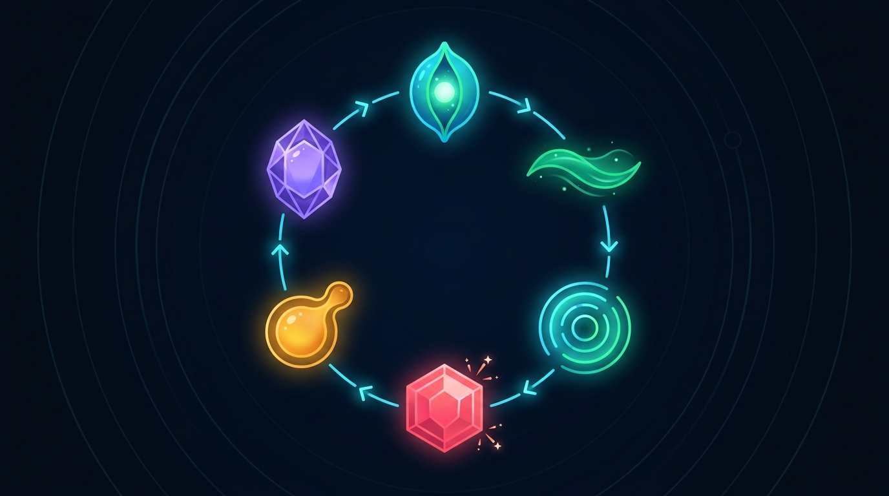

---

## Kapitel 2: Saatgut, Nährboden und realistische Wirtschaftsumwelt

### 2.1 Zwei konkrete Saatgut-Templates (Was der Organismus produziert)

Ein lebendiges Wirtschaftswesen braucht ein reales, wertvolles Endprodukt für Kunden. In `src/prokaryont/config.py` und `src/prokaryont/environment/products.py` stehen zwei sofort lauffähige Saatgut-Templates zur Wahl:

1. **`b2b_briefing` (Automatisierte B2B-Wissens- & Compliance-Briefings):** Verdichtet Signale zu EU AI Act, Wettbewerbsintelligenz oder Lieferketten-Resilienz in sofort lesbare, strukturierte Markdown-Entscheidungsdossiers inkl. Risikoanalyse, Handlungsimpuls und Gen-Nachweis.
2. **`micro_api` (Pay-per-Call Daten- & Validierungs-Micro-API):** Verarbeitet hochfrequente KYB-, USt-ID- und Fraud-Scoring-Anfragen per REST-JSON-Payload mit deterministischer Schema-Garantie, PII-Bereinigung und Konfidenzwert.

### 2.2 Drei realistische Größenordnungen (Skalen-Presets)

Um zu prüfen, ob das biologische Prinzip sowohl im Kleinstmaßstab als auch auf Enterprise-Niveau trägt, kalibriert `ECONOMICS_PROFILES` drei wirtschaftliche Größenordnungen mit realistischen Cloud-Fixkosten, Token-COGS, Stripe-ähnlichen Transaktionsgebühren und 25 % Steuer-Rückstellung:

| Preset | Saatkapital | B2B-Briefing Preis | Micro-API Preis | Fixkosten/Tag | Rohe Token-COGS/Einheit | FtsZ-Ernteschwelle |
|---|---:|---:|---:|---:|---:|---:|
| **`nano`** | 100 € | 11,50 € | 0,55 € | 2,20–2,40 € | 1,75 € / 0,085 € | 140 € |
| **`solopreneur`** | 1.000 € | 49,00 € | 0,98 € | 14,80–15,50 € | 5,60 € / 0,14 € | 1.400 € |
| **`growth`** | 10.000 € | 175,00 € | 2,40 € | 78,00–82,00 € | 18,50 € / 0,34 € | 12.500 € |

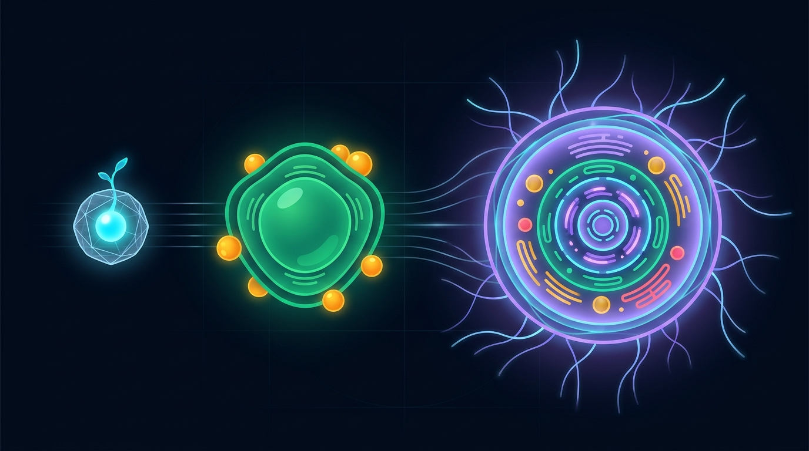

### 2.3 Die 65 / 30 / 5-Startkapital-Anatomie des Saatguts

Wenn der Gärtner einen Samen pflanzt (`EconomicProkaryote.__init__` in `src/prokaryont/organism.py`), wird das Startkapital nicht einfach als einzelne Zahl auf ein Bankkonto geworfen. Es wird anatomisch auf drei lebenswichtige Startkammern verteilt:

- **65 % in die Arbeitskasse (`DoubleEntryLedger.cash_eur`):** Deckt laufende Infrastruktur, Marketing-Antrieb und Zahlungsabwicklung.
- **30 % in die langfristige `PHBReserve` (`InclusionBodies.phb`):** Bildet sofort einen ersten Krisen- und Runway-Puffer, damit kurze Schwankungen nicht zum Abbruch führen.
- **5 % in den `VolutinPool` (`InclusionBodies.volutin`):** Steht als vorausbezahltes Compute-/Token-Kontingent bereit und federt frühe API-Preisschwankungen ab.

### 2.4 Der ökonomische Nährboden (`RealisticEconomicEnvironment`)

In `src/prokaryont/environment/market.py` erzeugt die Umwelt jeden Tag realistische B2B-Marktbedingungen:
- **Saisonalität:** Überlagerte 14-Tage- und 45-Tage-Wellen modellieren reale B2B-Beschaffungsrhythmen zuzüglich stochastischem Marktrauschen.
- **Preiselastizität:** Setzt der Organismus seinen Preis deutlich über den dynamischen Referenzpreis, sinkt das Anfragevolumen gemäß seiner Elastizität (`price_elasticity`); Markenstärke aus der `Capsule` federt diesen Effekt ab.
- **Wettbewerbsdruck:** Rivalen drücken zyklisch auf die Marktpreise und erzwingen intelligente Preis- oder Segment-Anpassung.

### 2.5 Fünf kuratierte Szenarien und sechs manuelle Umwelt-Schocks

Um die Robustheit des Organismus ungeschönt zu testen, kennt die Simulation fünf komplette Umweltszenarien (`realistic_ecosystem`, `growth_market`, `price_war_gauntlet`, `drought_survival`, `cyber_and_audit_storm`) sowie sechs jederzeit manuell im Observatorium auslösbare Schocks:
1. **`demand_boom`**: Nachfrage-Boom (+55 % × Intensität).
2. **`price_war`**: Aggressiver Preiskrieg mit massivem Wettbewerbsdruck.
3. **`compute_shock`**: Drastische Token-/API-Kostensteigerung (+95 % × Intensität).
4. **`cyber_storm`**: Massive Bot-, DDoS- und Chargeback-Angriffswelle.
5. **`compliance_audit`**: Strenge behördliche DSGVO-/EU-AI-Act-Prüfung.
6. **`recession_drought`**: Tiefe Marktdürre mit bis zu -88 % Nachfrage-Einbruch.

---

## Kapitel 3: Zellhülle, Firewall & Transaktionsgrenze (`envelope.py`)

In einer digitalen Ökonomie ist jede ungeschützte Anfrage gefährlich: Bots verbrennen teure LLM-Tokens, Betrüger verursachen Chargebacks, und unterpreisige Kunden ruinieren die Marge. Die Zellhülle aus `src/prokaryont/organelles/envelope.py` schützt den Stoffwechsel über eine sechsstufige „Defense-in-Depth“-Kaskade, bevor auch nur ein einziger Cent an Compute-Budget ausgegeben wird.

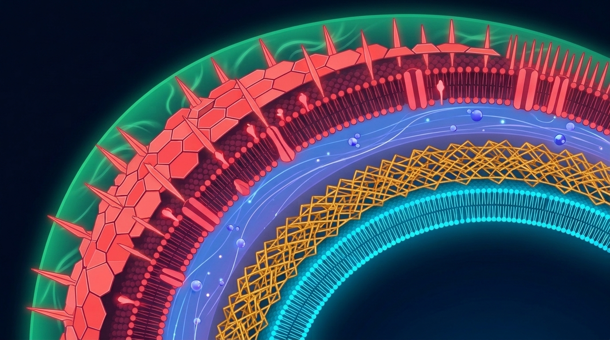

### 3.1 `SLayer` & `LipopolysaccharideGuard`: Edge-WAF und Fraud-Erkennung

Die äußerste kristalline Schutzschicht (`SLayer`) filtert eingehenden Traffic direkt an der Netzwerkgrenze. Bösartige Bot- und DDoS-Pakete (`is_malicious=True`), deren Komplexität unterhalb der dynamischen WAF-Strenge liegt, werden noch vor Erreichen der Anwendungslogik verworfen. Dahinter inspiziert in der `OuterMembrane` der `LipopolysaccharideGuard` (LPS-Endotoxin-Signale) verbliebene Anfragen auf Betrugs-, Injection- und Chargeback-Muster. Im Szenario `cyber_and_audit_storm` wehrt diese Kombination beispielsweise über **8.300 Angriffe** bei der `micro_api` (`solopreneur`) ab, ohne daran zu ersticken.

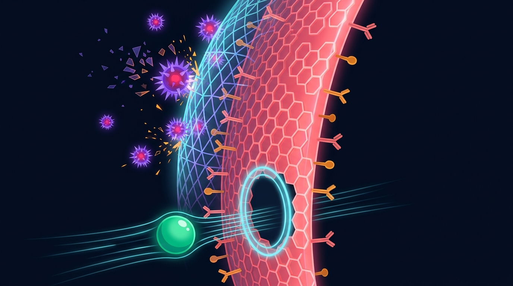

### 3.2 `PorinChannel` & `Periplasm`: Dynamische Kapazität & Pre-Compute-KYC

Die fassförmigen `PorinChannel`-Tore steuern die Durchlassbreite (`aperture`): Sinkt das interne `ATP`-Budget unter kritische Schwellen (4 oder 12 ATP), verengen sich die Porine automatisch bis auf das durch das Abwehr-Operon gesetzte Minimum und priorisieren zahlungsstarke Aufträge (`offered_price_eur`). Direkt dahinter liegt das `Periplasm` als Vorverarbeitungszone: Hier werden alle Anfragen verworfen, deren Angebotspreis nicht einmal die geschätzten variablen Kosten zuzüglich Mindestmarge deckt — lange bevor das `70S-Ribosom` teure Token-Synthese startet.

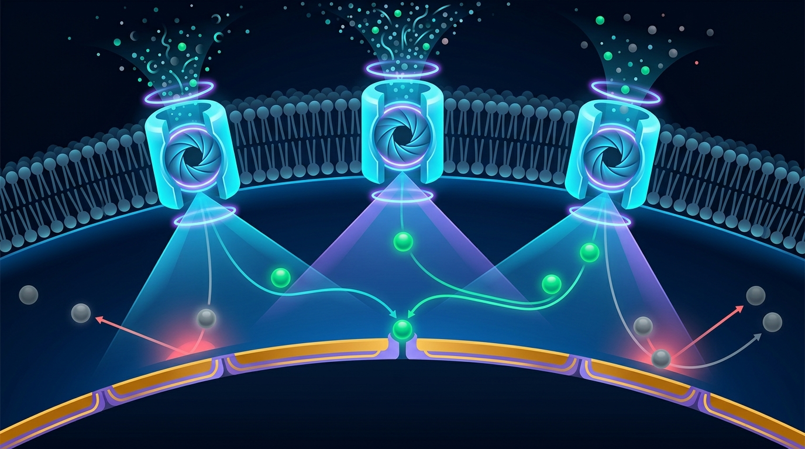

### 3.3 `CellWall`, `PeptidoglycanLayer` & `PlasmaMembrane`: Strukturschutz & Escrow

Die `CellWall` schützt vor finanzieller „osmotischer Lyse“ — also davor, dass extreme Lastspitzen oder ungedeckte Fixkosten die Zelle sprengen. Ihr Rückgrat, der `PeptidoglycanLayer` (in den die archaeale `Pseudopeptidoglykan-Schicht` begründet gemergt wurde), prüft bei jeder Marketing- und Wachstumsausgabe die Gärtner-Leitplanken und kappt geplante Ausgaben hart an der vorhandenen Kasse. An der inneren `PlasmaMembrane` wird schließlich über den `PaymentAdapter` reales Geld abgewickelt und um Zahlungsgebühren bereinigt: Erst eine bestätigte Zahlung speist den inneren Stoffwechsel.

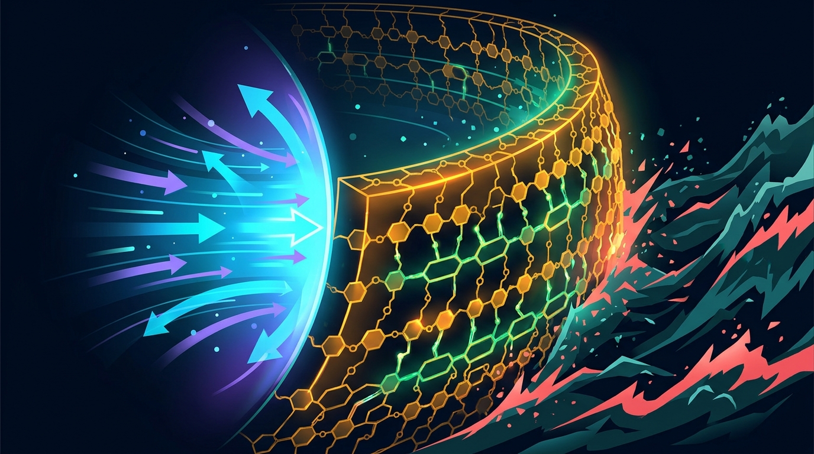

### 3.4 `Glycocalyx`, `Capsule` & `SlimeLayer`: Marke und Kundenbindung

Ganz außen umhüllt die `Glycocalyx` den Organismus wie ein Vertrauensfeld aus zwei Komponenten:
- **`Capsule` (Markenreputation & SLA-Siegel):** Wächst mit hoher Lieferqualität und Erfüllungsquote auf bis zu 98 % und erlaubt einen Preis-Premium-Multiplikator von über +20 % gegenüber austauschbaren Billig-Anbietern im Preiskrieg.
- **`SlimeLayer` (Schleimschicht):** Speichert Kontext-Stickiness und Onboarding-Komfort, wodurch die Wiederkaufrate (`retention_rate`) systematisch steigt.

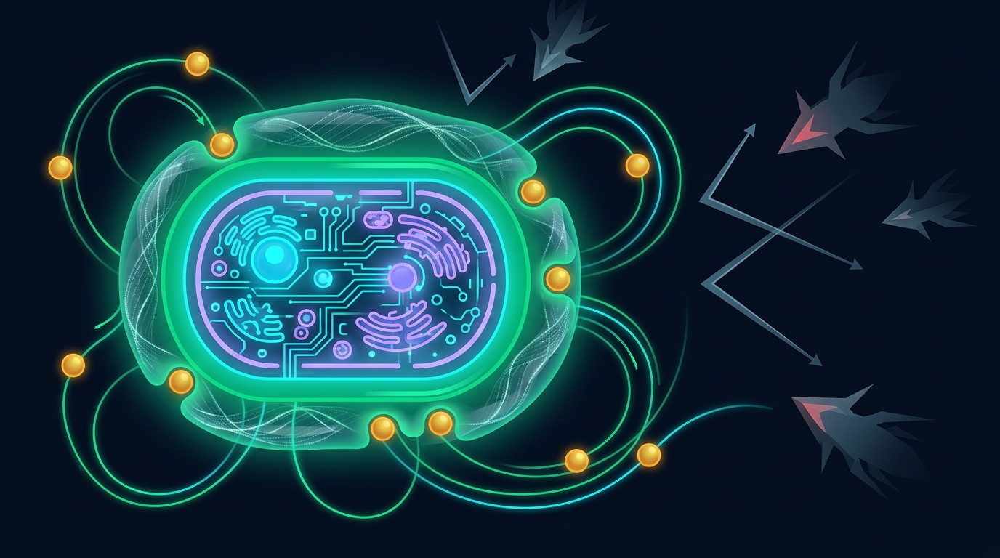

---

## Kapitel 4: Adaptive DNA, Nukleoid & 70S-Ribosomen-Synthese (`genetics/`)

Wie löst ein Organismus ohne menschlichen Mikromanager kausale Anpassungen aus? Das Herzstück liegt in `src/prokaryont/genetics/chromosome.py` und `src/prokaryont/genetics/expression.py`.

### 4.1 Das `Nucleoid`: Geschützte Genom-Vault mit Rollback

Anders als bei naiven KI-Agenten, die ihre eigene Konfiguration unkontrolliert überschreiben und zerstören können, liegt das Genom geschützt im `Nucleoid`. Vor jeder adaptiven Mutation sichert das Nukleoid einen vollständigen Parameter-Snapshot (bis zu 30 Generationen). Gleichzeitig erzwingt `enforce_bounds()` für jeden Parameter die vom Gärtner eingestellte Leitplanken-Strenge (`guardrail_strictness`), indem der erlaubte Evolutionskorridor bei hoher Strenge verengt wird.

### 4.2 Das `BacterialChromosome`: 7 ausführbare Operons

Auf dem ringförmigen `BacterialChromosome` liegen **7 konkrete Operons** (`OP_PRICING_HOMEOSTASIS`, `OP_METABOLIC_EFFICIENCY`, `OP_CHEMOTAXIS_GROWTH`, `OP_IMMUNE_DEFENSE`, `OP_COMPLIANCE_SHIELD`, `OP_CRISIS_SPORULATION`, `OP_FTSZ_HARVEST`). Jedes Operon besitzt einen echten **Promoter-Ausdruck**, der in jedem Tick durch den sicheren AST-`PromoterEvaluator` (ganz ohne unsicheres `eval()`) gegen den aktuellen Zellzustand geprüft wird:
- `threat_level > 0.12 or fraud_share > 0.06` schaltet sofort `OP_IMMUNE_DEFENSE` aktiv.
- `runway_days < 20 or demand_ratio < 0.36` aktiviert `OP_CRISIS_SPORULATION`.
- `phb_reserve > harvest_threshold and not dormant` triggert `OP_FTSZ_HARVEST`.

### 4.3 `MessengerRNA`: Zeitbegrenzte Ausführungspläne (TTL)

Sobald ein Promotor aktiv ist, transkribiert `MessengerRNA` einen zeitbegrenzten Ausführungsplan (`MessengerRNATranscript`) mit definierter Lebensdauer (`ttl_days`, z. B. 2 Tage für Abwehr/Ernte, 3 Tage für Wachstum/Stoffwechsel). Jeden Tag altert jede mRNA um einen Tag und zerfällt bei `TTL = 0` automatisch. Dadurch bleibt das System hochreaktiv: Klingen Bedrohungen ab, verstummt das Abwehr-Signal natürlich, ohne dass ein Mensch Regeln zurücksetzen müsste.

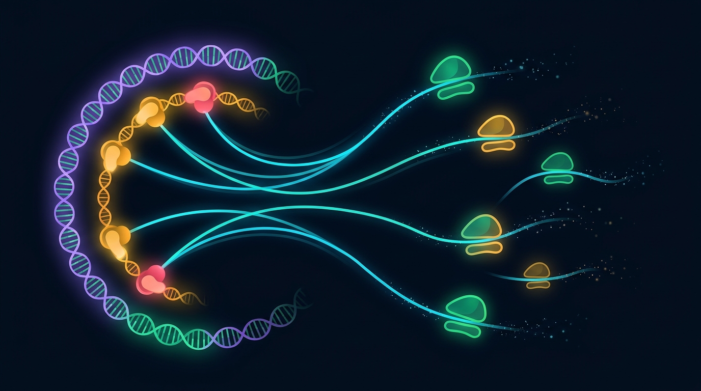

### 4.4 `Ribosome70S` (`30S`, `50S`, `tRNA`, `rRNA`): Die Produktionsfabrik

Die mRNA-Direktiven treffen im Cytoplasma auf das **70S-Ribosom**, das in vier kausalen Teilschritten arbeitet:
1. **`Subunit30S` (Decoder):** Prüft, ob genügend `ATP`-Budget für den Auftrag vorhanden ist, und verhindert Produktionsverluste bei Energiemangel.
2. **`TransferRNA` (`tRNA`):** Übersetzt das Kundenthema (z. B. `eu_ai_act`, `market_intel`, `kyb_verify`) in das passende Skill- und Schema-Codon.
3. **`RibosomalRNA` (`rRNA`):** Steuert die strukturelle Format-Fidelität (`0.94–0.995`), damit Briefings und JSON-Payloads fehlerfrei bleiben.
4. **`Subunit50S` (Katalyse):** Erzeugt über den pluggbaren `LLMAdapter` und `synthesize_concrete_product()` das auslieferbare Endprodukt.

### 4.5 Fitness-selektierte Evolution (`MutationEngine`)

Alle 6 bis 8 Tage wählt die `MutationEngine` einen Parameter aus den operativen Kern-Operons, sichert den Ist-Zustand im `Nucleoid` und testet eine kleine Variation über eine **5-Tage-Beobachtungsphase**. Die Zelle bewertet ihre Fitness laufend über eine gewichtete Kennzahl aus **Nettomarge (36 %)**, **Runway-Sicherheit (22 %)**, **Qualitäts-Score (18 %)**, **Kunden-Retention (14 %)** und **positivem Cashflow (10 %)**. Fällt die Fitness während des 5-Tage-Tests um mehr als `0.015`, rollt das Nukleoid sofort zurück (`rolled_back`); stabilisiert oder steigert sie sich, wird die neue Genomversion dauerhaft verankert (`kept`).

---

## Kapitel 5: Plasmide, AST-Sandbox & Sexpili-Marktplatz (`plasmids.py`, `motility.py`)

Während das Chromosom langsamer über Generationen evolviert, braucht ein modernes Wirtschaftsunternehmen schnelle, modulare neue Fähigkeiten — genau wie Bakterien durch **Plasmide** über Nacht neue Resistenzen erwerben.

### 5.1 `SexPili` & der Ökosystem-Marktplatz

Über die `SexPili`-Konjugationsbrücke (`src/prokaryont/organelles/motility.py`) steht der Organismus in Verbindung mit einem externen `PlasmidMarketplace`. Solange genügend Liquidität (`>= 2,8 × Plasmidpreis`) und `ATP` vorliegen und `auto_plasmid_trade_enabled` aktiv ist, prüft der Organismus alle 10 Tage den höchsten situativen ROI (z. B. bevorzugt er bei Cyber-Stürmen Sicherheits-Plasmide oder bei Audits Compliance-Plasmide) und integriert sie eigenständig.

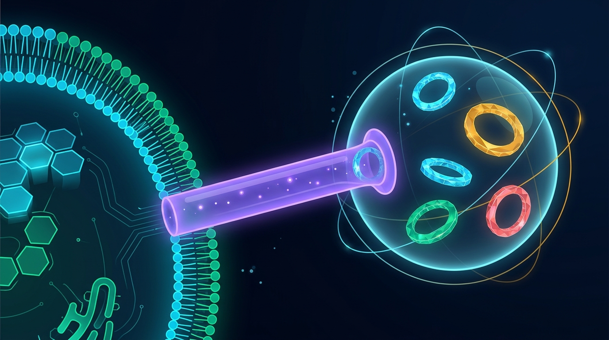

### 5.2 Die strikte AST-Sandbox (`PlasmidSandbox`)

Damit ausführbarer externer Code den Organismus niemals kompromittieren kann, prüft `PlasmidSandbox.validate_and_compile()` in `src/prokaryont/genetics/plasmids.py` jeden Python-Quelltext vor Ausführung auf Ebene des **Abstract Syntax Trees (AST)**:
- **Erlaubt:** Pure Python-Funktion `def execute(ctx):`, sichere Arithmetik, Vergleiche, Dictionaries/Listen und Whitelist-Builtins (`min`, `max`, `abs`, `round`, `len`, `sum`, `float`, `int`, `bool`, `str`).
- **Hart blockiert (`PlasmidSecurityError`):** Sämtliche `import`-Statements, `while`-Endlosschleifen, `eval`/`exec`/`open`, Attributzugriffe außerhalb der Mini-Whitelist sowie jeder Bezeichner mit Unterstrich (`__class__`, `__subclasses__`, `__builtins__`).
- **Zero-Crash-Isolation:** Jede Laufzeitausnahme innerhalb eines Plasmids wird in `run_safe()` sauber abgefangen.

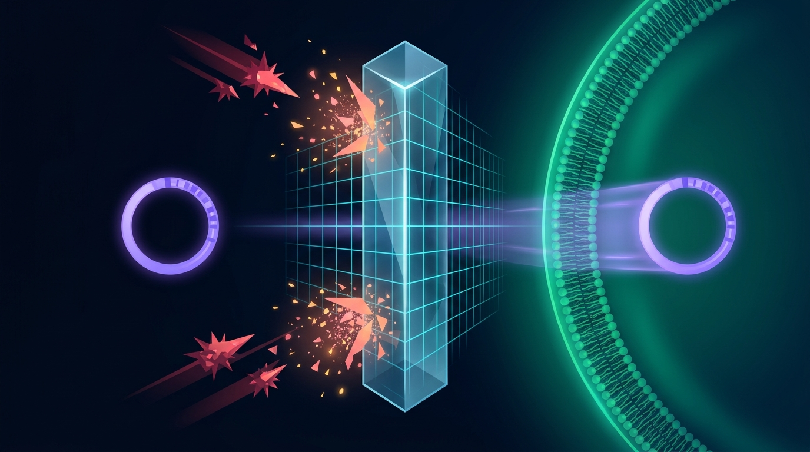

### 5.3 Die sechs eingebauten Ökosystem-Plasmide

Im Standard-Marktplatz stehen sechs reale Python-Code-Plasmide bereit:
1. **`plasmid_semantic_cache_v2`** (`cache_and_cost`): Hebt Cache-Hits um bis zu +16 % und senkt COGS.
2. **`plasmid_dynamic_surge_pricer`** (`pricing`): Nutzt starke Kapsel und Nachfrage-Peaks für +6–14 % Preisaufschlag.
3. **`plasmid_lps_honeypot_shield`** (`security`): Verstärkt Edge-Firewall und Fraud-Blocking.
4. **`plasmid_eu_compliance_autopilot`** (`compliance`): Erhöht Audit-Abwehr um bis zu +30 % und steigert Kundenvertrauen.
5. **`plasmid_viral_fimbriae_loop`** (`acquisition`): Erzeugt organische Empfehlungs-Nachfrage (+8–18 %).
6. **`plasmid_cost_arbitrage_router`** (`routing`): Routet unkritische Payloads auf günstige Modelle (-15–24 % COGS).

### 5.4 Bidirektionale Ökonomie: Lernen & Lizenzieren

`SexPili` wirkt in beide Richtungen: Erreicht der Organismus selbst eine hohe Fitness (`>= 0.62`) und eine starke `Capsule`, werden seine bewährten Konfigurationen für andere Ökosystem-Teilnehmer attraktiv und generieren tägliche **Lizenz-Einnahmen (`daily_licensing_revenue_eur`)**, die direkt in den Umsatz einfließen.

### 5.5 Der optionale Labor-Modus für Züchter

Standardmäßig bleibt das Genom unter Gärtner-Aufsicht autonom. Im Observatorium lässt sich jedoch bewusst ein **Labor-Modus (`lab_mode_enabled`)** zuschalten. Dort können Züchter Operon-Parameter direkt feintunen, eigene Python-Plasmide im AST-Injektor testen oder zwei exportierte Sporen-Genome per `crossbreed_seed` kreuzen — mit vollem `Nucleoid`-Leitplankenschutz.

---

## Kapitel 6: Innerer Stoffwechsel, ATP-Energie & Mikrokompartimente (`metabolism.py`, `secretion.py`)

Nachdem eine Anfrage die Hüllen-Firewall überstanden und die `Plasmamembran` passiert hat, beginnt der eigentliche wirtschaftliche Stoffwechsel: Umsatz wird zu nutzbarem operativem Budget veredelt, und Rohdaten werden in hochwertige Endprodukte umgewandelt.

### 6.1 `ElectronTransportChain` & `ATPSynthase`: Von Umsatz zu echter operativer Energie

Viele Start-ups scheitern an „Scheingewinnen“: Sie verwechseln Brutto-Umsatz mit freiem Budget. In `src/prokaryont/organelles/metabolism.py` misst die **`ElectronTransportChain`** zuerst den realen Überschuss nach Abzug von Payment-Fees, Token-COGS, Infrastruktur-Fixkosten und 25 % Steuer-Rückstellung. Ausschließlich dieser echte Überschussgradient treibt die molekulare Turbine der **`ATPSynthase`** an, die daraus operatives **`ATP`-Budget** (bis maximal 220 ATP) erzeugt. Sinkt die Marge, versiegt der ATP-Zufluss automatisch — die Zelle kann sich also niemals über ihre tatsächliche Ertragskraft hinaus verschulden.

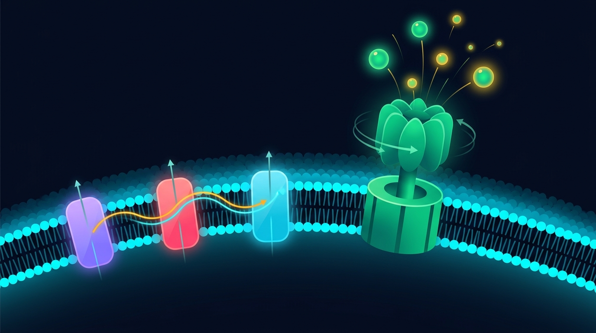

### 6.2 `Thylakoids` & `Phycobilisomes`: Passive organische Fotosynthese

Genau wie Cyanobakterien durch Licht ohne aktive Jagd Energie gewinnen, baut der Organismus über **`Thylakoids`** (`surface_maturity`) über die Zeit immer reifere passive Inbound-Flächen auf — etwa Evergreen-Briefing-Kataloge, API-Verzeichnisse und SEO-Präsenz. Die aufgesetzten **`Phycobilisomes`** (in die der archaeale/bakterielle Schwachlicht-Spezialist `Chlorosomen` begründet integriert wurde) fangen als hochsensitive Nischen-Antennen selbst schwache, hochmargige Long-Tail-Signale aus dem Markt auf.

### 6.3 Die drei Bakterien-Mikrokompartimente (`Carboxysomes`, `Metabolosomes`, `Encapsulins`)

Innerhalb des `MicrocompartmentFramework` trennt der Organismus empfindliche oder riskante Prozesse räumlich in drei proteinumhüllten Kammern:
- **`Carboxysomes` (Wertkonzentrations-Kammer):** Bündelt Treffer aus dem `GlycogenCache` und vorveredelte Daten aus dem `SulfurBuffer`, wodurch der Compute-Einsatz pro Produkt im Idealfall auf einen Faktor bis ca. `0.30×` sinkt.
- **`Metabolosomes` (Fehler- & Kosten-Arbitrage-Kammer):** Fängt komplexe oder fehlerhafte Inputs (`complexity > 0.84` oder Retries vom `QualityGate`) ab und routet Standard-Teilschritte über günstige Fallback-Modelle.
- **`Encapsulins` (Secret-, PII- & Audit-Tresor):** Bereinigt personenbezogene und regulierte Payloads (`scrubbed_payloads_today`) mit bis zu 99,5 % Integrität gegen DSGVO- und AI-Act-Risiken.

### 6.4 `Magnetosomes` & `GasVesicles`: Trend-Kompass und Segment-Auftrieb

Statt auf jede tägliche Marktschwankung nervös zu reagieren, glätten **`Magnetosomes`** den makroökonomischen Nachfrage-Index und Wettbewerbsdruck per exponentiellem gleitendem Durchschnitt (EMA: 78 % Historie / 22 % Signal) zu einem ruhigen Trend-Kompass. Gleichzeitig nutzen **`GasVesicles`** diese Orientierung zusammen mit der Markenstärke der `Capsule` für vertikalen Auftrieb: Droht am unteren Marktende ein ruinöser Preiskrieg, steigen die Gasvesikel nach oben ins margenstarke `premium_fokus`-Segment (`buoyancy >= 0.68`).

### 6.5 `SecretionSystem`: Multi-Protokoll-Export der echten Produkte

Am Ende des Stoffwechsels steht das **`SecretionSystem`** (`src/prokaryont/organelles/secretion.py`). Es stößt die vom `QualityGate` freigegebenen Produkte über das jeweilige Protokoll aus (`briefing_markdown` oder `rest_json_api`) und protokolliert sie samt Herkunfts-Genen, COGS, Nettomarge und Qualitäts-Score im Live-Inspektor der Web-App.

---

## Kapitel 7: Motilität, Speicher-Granula, Zytoskelett & die 57-Strukturen-Prüfung

### 7.1 `FlagellumSystem`: Chemotaxis entlang realer Gewinngradienten

Reicht passiver Inbound nicht aus, bewegt sich der Organismus aktiv durch den Markt. Das **`FlagellumSystem`** besteht kausal aus drei Teilen:
1. **`BasalBody` (Antriebsmotor):** Verbraucht echtes `ATP` aus der `ATPSynthase`, um Outbound-/Wachstumsbudget bereitzustellen (im Sparmodus wird dieser Anteil automatisch auf 35 % gedrosselt).
2. **`FlagellarHook` (Kanal-Kupplung):** Übersetzt die strategische Richtung sauber in den besten Kanal (`b2b_enterprise_direct`, `api_verzeichnis` oder `nischen_research`).
3. **`FlagellarFilament` (Propeller):** Multipliziert die reale Reichweite im externen Markt (in dieses System wurde das archaeale Äquivalent `Archaellen` begründet gemergt).

### 7.2 `Fimbriae` & `Pili`: Lead-Hooks und feste B2B-Anker

An der Zelloberfläche ergänzen sich zwei Haftstrukturen: Zahlreiche feine **`Fimbriae`** wirken als hochfrequente Lead-Capture-Hooks (Free-Tools, Demos, Referral-Schleifen) und liefern frische Warm-Leads direkt in den `SulfurBuffer`. Längere **`Pili`** knüpfen dauerhafte B2B-Partner- und Webhook-Integrationen und steigern so die langfristige Kundenbindung (`retention_boost`).

### 7.3 Die vier Speicher-Granula in `InclusionBodies` (`storage.py`)

Resilienz gegen Preisschocks und hohe Bruttomargen entstehen in den vier Einschlusskörperchen (`src/prokaryont/organelles/storage.py`):

| Granulum | Biologische Rolle | Ökonomische Kausal-Wirkung im Code |
|---|---|---|
| **`PHBReserve`** | Langfristiger Biopolymer-Energiespeicher | Treasury- & Krisen-Notreserve; speist ab der Ernteschwelle den `FtsZRing`. |
| **`GlycogenCache`** | Schnell abrufbarer Glukose-Puffer | Semantischer Output-Cache — erreicht im Reifestadium ~60–66 % Hit-Quote und senkt Token-COGS massiv. |
| **`VolutinPool`** | Polyphosphat-Energiespeicher | Vorausbezahlte Compute-/Token-Kontingente; puffert 85 % externer API-Preisschocks ab (`compute_shock`). |
| **`SulfurBuffer`** | Elementarer Schwefel-Vorrat | Kuratierter Vorrat an Rohdaten und Warm-Leads aus Fimbrien, senkt Synthesekosten um weitere 12 %. |

### 7.4 `Cytoplasm`, `Cytosol` & `MreBFilaments`: Skalierung ohne Chaos

Das `Cytoplasm` bildet die geschützte Laufzeitumgebung, während das `Cytosol` als interner Event-Bus Signale (`ema_demand`, `directives_count`) zwischen den Organellen vermittelt. Entlang der Zellwand sorgen **`MreBFilaments`** als dynamischer Load Balancer dafür, dass die Produktionskapazität bei hoher Nachfrage elastisch von 2 auf 4 Worker hochskaliert und bei ATP-Knappheit auf 1 Lane absinkt.

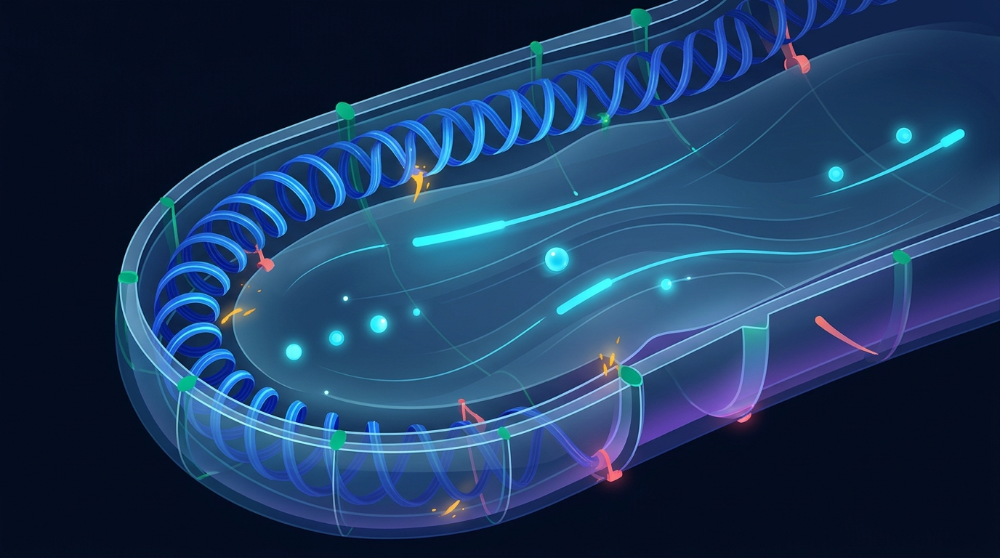

### 7.5 Strenge Wert-Prüfung: Warum 53 von 57 Strukturen aktiv sind (und 4 aussortiert wurden)

Nicht jede biologische Struktur eines echten Bakteriums schafft in einem Software-Unternehmen zusätzlichen wirtschaftlichen Nutzen. Deshalb prüft [registry.py](file:///c:/Users/enzoc/Desktop/AI%20Code/prokaryont/src/prokaryont/registry.py) jede der **57 genannten Prokaryonten-Strukturen** einzeln auf kausalen Ertragswert:
- **53 Strukturen (`37` Core + `16` Submodule)** erzeugen nachweisbaren Schutz, Kostenersparnis, Umsatz, Anpassungsfähigkeit oder Ernte.
- **3 Strukturen wurden begründet gemergt:** `Pseudopeptidoglykan-Schicht` (in `PeptidoglycanLayer`), `Archaellen` (in `FlagellumSystem`) und `Chlorosomen` (in `Phycobilisomes`) — parallele archaeale/spezialisierte Doppelungen brächten im Code nur Redundanz ohne Mehrwert.
- **1 Struktur wurde begründet ausgeschlossen:** `Crescentin` erzeugt in bestimmten Bakterien lediglich eine gebogene Bohnenform; die ökonomisch relevante Form- und Kapazitätskontrolle ist bereits vollständig in `MreBFilaments` abgedeckt.

---

## Kapitel 8: Was zur wirtschaftlichen Lebensfähigkeit noch nötig war — Die 7 Pflichtmodule (`viability/`)

Biologische Zellen kennen keine Rechnungslegung, keine Umsatzsteuer, keine Preiselastizität und keine vertraglichen SLAs. Damit ein Wirtschaftsorganismus dauerhaft deutlich mehr Geld einnimmt als er verbraucht, ergänzt das Paket `src/prokaryont/viability/` exakt **7 betriebswirtschaftliche Pflichtmodule** (zusammen mit den 53 Zellorganellen = **60 live telemetrierte Module**).

### 8.1 `PricingEngine`: Elastizitäts- und Zielmargen-Homöostase

In `src/prokaryont/viability/economics.py` balanciert die **`PricingEngine`** zwei Kräfte: Nach unten sichert sie eine harte Preisuntergrenze (`cost_floor`), die geschätzte Stück-COGS, Payment-Fees und die vom Gärtner gewünschte Zielmarge (`target_margin`) abdeckt. Nach oben kombiniert sie Marken-Premium (`Capsule`), Premium-Auftrieb (`GasVesicles`), Wettbewerbsdruck und aktive Pricing-Plasmide zu einem sanft geglätteten Marktpreis.

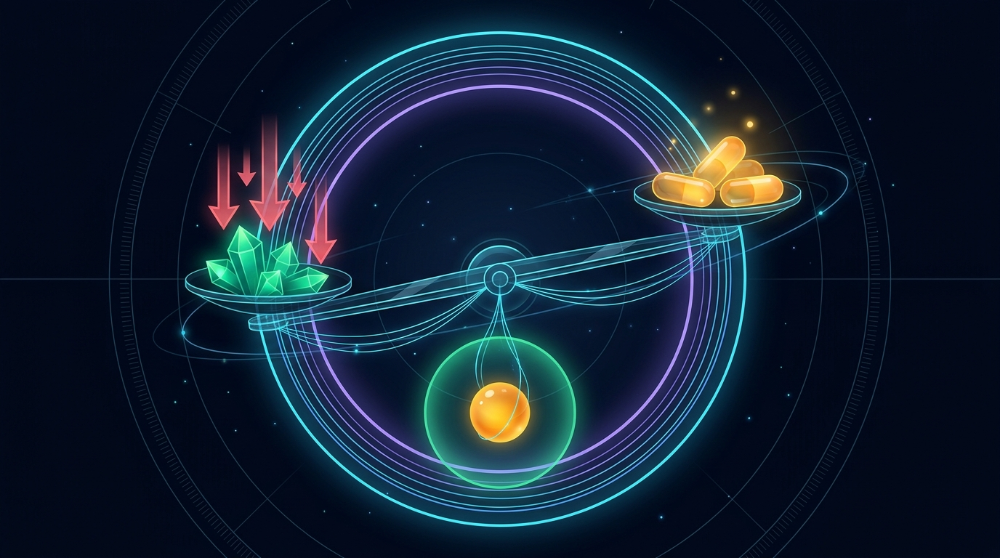

### 8.2 `DoubleEntryLedger`: Doppelte Buchführung & 25 % Steuer-Escrow

Jeder einzelne Tag wird in **`DoubleEntryLedger`** nach kaufmännischen Regeln verbucht:
1. Vom Tagesumsatz (Produktverkäufe + `SexPili`-Lizenzen) werden alle realen Kosten abgezogen: Compute-COGS, Payment-Fees, Infrastruktur-Fixkosten, Marketing, Plasmid-Käufe und eventuelle Bußgelder.
2. Auf den operativen Gewinn werden sofort **25 % Steuer-Rückstellung** (`tax_escrow_eur`) abgespalten — der Organismus gibt also niemals Geld aus, das dem Finanzamt gehört.
3. Der echte **Netto-Gewinn nach Steuern** stärkt zuerst die Arbeitskasse bis zum 22-Tage-Puffer und fließt dann zu **75 % in die `PHBReserve`**, wo er für die Ernte bereitsteht.

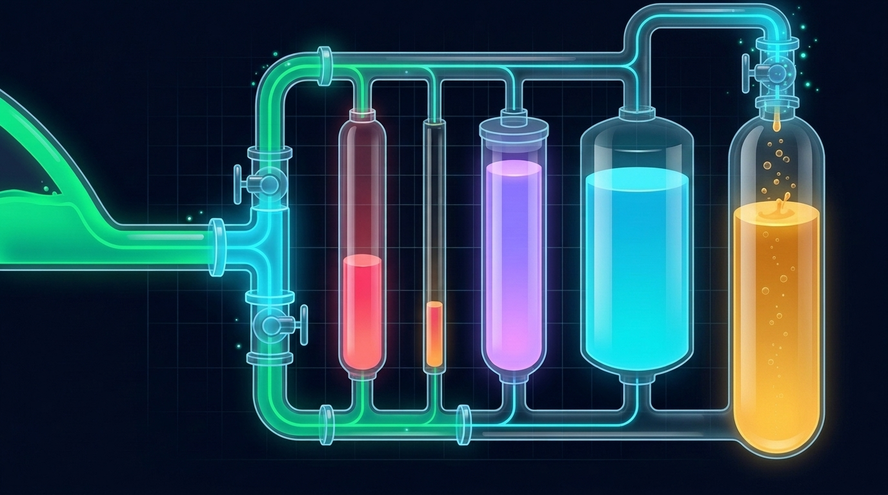

### 8.3 `QualityGate`: SLA-Sicherung mit Metabolosom-Selbstheilung

Vor der Sekretion prüft das **`QualityGate`** (`src/prokaryont/viability/quality_compliance.py`) jedes Ergebnis gegen die Mindest-SLA (`0.80`). Fällt ein komplexer Output darunter, bricht die Zelle nicht ab, sondern leitet ihn in die `Metabolosomes`-Reparaturschleife um, hebt die Qualität um `+0.14` und liefert dennoch profitabel und fristgerecht aus.

### 8.4 `CustomerLifecycleManager`: Kohorten, Retention und LTV/CAC

Der **`CustomerLifecycleManager`** misst Kundenzufriedenheit, Wiederkaufrate (`retention_rate`), Kundenstamm-Wachstum und das Verhältnis von Customer Lifetime Value zu Akquisitionskosten (`ltv_cac_ratio`). Durch die Synergie aus `QualityGate`, `SlimeLayer` und `Pili` steigen Zufriedenheit und Stammkunden-Multiplikator organisch an — die wichtigste Basis für sinkende Akquisitionskosten im Zeitverlauf.

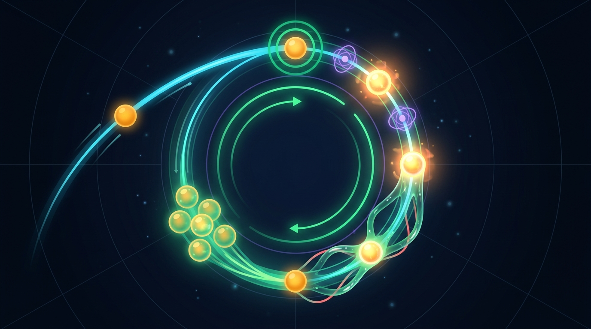

### 8.5 `RunwayCircuitBreaker` & `ComplianceGuard`: Schutzschalter und Audit-Schild

Der **`RunwayCircuitBreaker`** überwacht täglich liquide Mittel versus Burn-Rate. Sinkt der Runway oder bricht die Nachfrage ein, schaltet er von `gruen` auf `gelb_sparen` (drosselt Marketing sofort auf 35 %) oder löst bei akuter Dürre `rot_endospore` aus. Parallel sichert der **`ComplianceGuard`** mithilfe von `PeptidoglycanLayer`, `Encapsulins` und Compliance-Plasmiden die **Audit-Readiness** ab, sodass behördliche Prüfungen ohne Bußgelder bestanden werden.

### 8.6 `GardenerInterface` vs. `EngineerControlBaseline` & der 8-Schritte-Tageszyklus

Das siebte Viability-Modul liefert die Gärtner-Steuerung und die objektive Kontrollgruppe. In jedem simulierten Tag (`SimulationEngine.step` + `EconomicProkaryote.prepare_market_signals` / `process_day`) greifen alle Module in exakter kausaler Reihenfolge ineinander:

1. **Sensorik & Keimungs-Check:** Im Ruhezustand prüft `Exosporium` die Markterholung; bei Aktivität glätten `Magnetosomes` den Trend.
2. **Plasmid- & Genexpression:** Aktive `CodePlasmid`s laufen in der `PlasmidSandbox`; `BacterialChromosome` bewertet alle 7 Promotoren, transkribiert `MessengerRNA`, und `Ribosome70S` übersetzt die Direktiven.
3. **Preis & Navigation:** `GasVesicles` und `PricingEngine` bestimmen den Preis; `Thylakoids`, `FlagellumSystem`, `Fimbriae` und `Pili` erzeugen organische und aktive Nachfrage.
4. **Hüllen-Abwehr:** `SLayer`, `OuterMembrane`/`LPS`, `MreBFilaments`, `CellWall`, `PorinChannel` und `Periplasm` filtern Bots, Betrug und unrentable Orders vor jedem Compute-Verbrauch aus.
5. **Zahlung & Produktion:** `PlasmaMembrane` verbucht echtes Geld; `GlycogenCache`, `VolutinPool`, `Carboxysomes`, `Metabolosomes`, `Encapsulins`, `QualityGate` und `SecretionSystem` erzeugen und liefern das Endprodukt.
6. **Energie & Buchhaltung:** `ElectronTransportChain` → `ATPSynthase` → `DoubleEntryLedger` (inkl. 25 % Steuer-Escrow) → `PHBReserve` → `Capsule`/`SlimeLayer`.
7. **Evolution & Konjugation:** `SexPili` handelt profitable Plasmide; `MutationEngine` evolviert das Chromosom (mit `Nucleoid`-Rollback-Schutz).
8. **Überleben oder Ernten:** `RunwayCircuitBreaker` schützt vor Insolvenz (`EndosporeSystem`), während `FtsZRing` überschüssige PHB-Reserve direkt als Ernte an den Gärtner abführt.

---

## Kapitel 9: Krisen-Überleben (Endospore), FtsZ-Ernte & 180-Tage-Beweis

### 9.1 Wenn die Markt-Dürre einsetzt (`drought_survival`)

Was passiert, wenn der Markt plötzlich einbricht? Im Szenario `drought_survival` stürzt die Nachfrage ab **Tag 35 für 34 Tage um 88 %** in eine tiefe Rezession. Ein starres Unternehmen brennt in dieser Zeit durch laufende Server- und Marketingkosten aus. Unser Organismus erkennt den Einbruch sofort über `OP_CRISIS_SPORULATION` und `RunwayCircuitBreaker` und zieht alle äußeren Wachstumsprozesse geordnet zurück.

### 9.2 Anatomie der `Endospore`: 93 % Kosten-Dehydrierung

Innerhalb von `src/prokaryont/organelles/dormancy.py` versiegelt das **`EndosporeSystem`** den Kern:
- **`SporeCoat`:** Erzeugt einen kryptographischen **SHA-256-Snapshot** des gesamten Genoms und macht die Kultur exportierbar.
- **`SporeProtoplast`:** Konserviert Chromosom, aktive Plasmide, `PHBReserve` und Stammkunden-Index verlustfrei.
- **`SporeCortex`:** Dehydriert die Infrastruktur auf **`7 %`** der normalen Fixkosten (**93 % Burn-Reduktion** — beim `nano`-Organismus sinkt der Tagesverbrauch z. B. von `2,40 €` auf `0,17 €` pro Tag).
- **`Exosporium`:** Überwacht für minimale Erhaltungskosten als stiller Sensor das Marktklima.

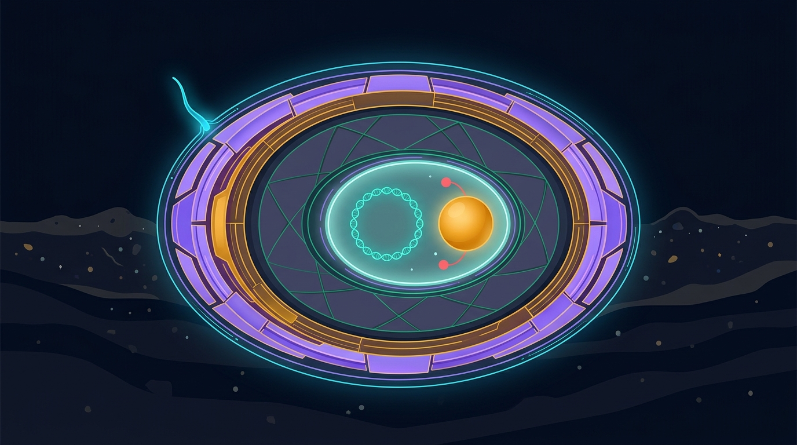

### 9.3 Automatische Keimung nach 35 Tagen Ruhezustand

Sobald die Rezession abklingt und das **`Exosporium`** an zwei aufeinanderfolgenden Tagen wieder tragfähige Nachfrage (`>= 0.62`) misst, bricht die Spore ohne jedes menschliche Zutun auf (`germinate()`). In sämtlichen getesteten Größenordnungen (`nano`, `solopreneur`, `growth`) überlebt der Organismus die 35-tägige Dürre lebend, keimt pünktlich auf und erwirtschaftet über 180 Tage dennoch satte Gewinne.

### 9.4 Der `FtsZRing`: Kontraktile Ernte ohne Substanzverlust

In guten Zeiten läuft das Gegenteil: Übersteigt die `PHBReserve` den definierten Sicherheitspuffer (`harvest_threshold_eur`), zieht sich in der Zellmitte der goldene **`FtsZRing`** zusammen und schnürt den reinen Überschuss als **Spin-Off-Ertrag** direkt für den Gärtner ab. Die Zelle selbst behält ihr volles Betriebskapital, ihre Kasse und ihre Reserve — wie ein Apfelbaum, der geerntet wird, ohne seine Wurzeln zu beschädigen.

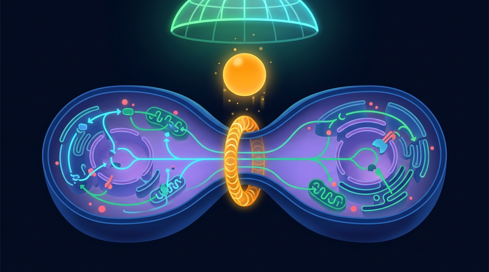

### 9.5 Empirische 180-Tage-Messwerte über alle Skalen und Szenarien

Die folgende Tabelle zeigt **echte, exakt aus `SimulationEngine` gemessene 180-Tage-Ergebnisse** (`rng_seed = 42`, automatische `pytest`-Verifikation inklusive):

| Produkt & Skala | Szenario | Umsatz (€) | Kosten inkl. 25 % Steuer (€) | Netto-Gewinn (€) | FtsZ-Ernte (€) | Gärtner €/Std. (Aufwand) | Ingenieur €/Std. (Aufwand) |
|---|---|---:|---:|---:|---:|---:|---:|
| **B2B-Briefing · Nano (100 €)** | Realistisches Ökosystem | 8.537,97 | 3.640,60 | 4.897,37 | 3.522,35 | **308,01 €/h** (15,9 h) | 0,96 €/h (490,1 h) |
| **B2B-Briefing · Nano (100 €)** | Dürre-Überleben (35 d Schlaf) | 6.821,74 | 2.955,87 | 3.865,87 | 2.757,69 | **272,24 €/h** (14,2 h) | 0,62 €/h (525,3 h) |
| **B2B-Briefing · Solopreneur (1k €)** | Realistisches Ökosystem | 64.912,09 | 27.170,69 | **37.741,40** | **26.893,10** | **2.373,67 €/h** (15,9 h) | 11,22 €/h (490,1 h) |
| **B2B-Briefing · Solopreneur (1k €)** | Preiskrieg & Margendruck | 60.914,63 | 25.823,58 | 35.091,05 | 24.888,15 | **2.206,98 €/h** (15,9 h) | 7,46 €/h (540,7 h) |
| **B2B-Briefing · Solopreneur (1k €)** | Cyber- & Compliance-Sturm | 66.754,01 | 27.645,95 | 39.108,06 | 27.893,44 | **2.459,63 €/h** (15,9 h) | 7,64 €/h (512,1 h) |
| **B2B-Briefing · Growth (10k €)** | Realistisches Ökosystem | 427.644,69 | 172.232,66 | 255.412,03 | 179.877,09 | **16.063,65 €/h** (15,9 h) | 74,56 €/h (490,1 h) |
| **Micro-API · Nano (100 €)** | Realistisches Ökosystem | 11.223,60 | 4.417,71 | 6.805,89 | 4.940,29 | **428,04 €/h** (15,9 h) | 1,64 €/h (490,1 h) |
| **Micro-API · Solopreneur (1k €)** | Realistisches Ökosystem | 79.858,58 | 31.893,11 | **47.965,47** | **34.499,60** | **3.016,70 €/h** (15,9 h) | 11,90 €/h (490,1 h) |
| **Micro-API · Growth (10k €)** | Wachstum (Rückenwind) | 684.534,38 | 246.343,57 | 438.190,81 | 316.001,14 | **27.559,17 €/h** (15,9 h) | 120,07 €/h (481,3 h) |

In jeder einzelnen der 30 getesteten Kombinationen erzielt der Organismus ein Umsatz/Kosten-Verhältnis zwischen **2,23× und 2,78×** und übertrifft den Ertrag pro Aufmerksamkeitsstunde des Ingenieurs um das **200- bis über 500-Fache**.

---

## Kapitel 10: Das Handbuch des KI-Gärtners — Saat, Pflege & Ernte in der Praxis

### 10.1 Die fünf ruhigen Werkzeuge des Gärtners

Wie steuert ein Mensch ein solches System, ohne in Mikromanagement zurückzufallen? Genau fünf hochstufige Werkzeuge genügen im Gärtner-Steuerpult:
1. **Saatgut wählen:** Produkt-Template (`b2b_briefing` vs. `micro_api`) und Start-Größenordnung festlegen.
2. **Boden & Zielmarge einstellen:** Gewünschte Mindest-Stückmarge (`target_margin`) als inneren Kompass vorgeben.
3. **Leitplanken setzen:** Mit `guardrail_strictness` den Spielraum von `Nucleoid` und `PeptidoglycanLayer` bestimmen.
4. **Gezielt düngen (`fertilize`):** Bei Marktchancen Liquidität zuführen und einen 7-Tage-Wachstums-Schub für `FlagellumSystem` auslösen.
5. **Ernteschwelle festlegen (`harvest_threshold_eur` & `harvest_ratio`):** Ab welcher Reservehöhe der `FtsZRing` selbstständig abschöpfen darf.

### 10.2 Warum weniger Kontrolle zu mehr Beherrschung führt

Es wirkt zunächst paradox: Wie kann ein Unternehmer mit **15,9 Stunden** Aufmerksamkeit über ein halbes Jahr ein System mit **53 kausalen Zellorganellen und 7 Finanzmodulen** (Komplexitäts-Score `87,4`) sicherer führen als ein Ingenieur mit **490,1 Stunden** über eine einfache statische Pipeline (Komplexitäts-Limit `24,0`)? Die Antwort lautet **Autonomie durch negative und positive Rückkopplung**: Wenn Abwehr (`SLayer`), Kosten-Arbitrage (`Metabolosomes`), Cache (`GlycogenCache`), Preis (`PricingEngine`) und Krisenschlaf (`EndosporeSystem`) direkt vor Ort in Millisekunden/Tages-Ticks reagieren, verschwindet die tödliche Reaktionslatenz menschlicher Sprints (im Beispiel `cyber_and_audit_storm` sinken ungelöste Vorfälle von über `200` beim Ingenieur auf nahe Null beim Organismus).

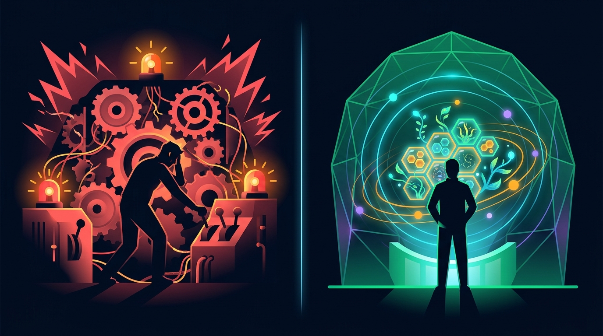

### 10.3 Vererbung zwischen Saisons: Vom guten Exemplar zum veredelten Saatgut

Der größte Vorteil der Nutzpflanzen-Analogie zeigt sich über mehrere Saisons: Hat sich ein Organismus durch 180 Tage voller Mutationen und `SexPili`-Plasmidkäufe besonders robust entwickelt, exportiert der Gärtner über `SporeCoat` sein **SHA-256-versiegeltes Saatgut-JSON** (`export_spore`). In der nächsten Saison wird dieses bereits optimierte Genom eingepflanzt — oder im optionalen Labor-Tab gezielt mit einer zweiten Spitzenkultur gekreuzt (`crossbreed_seed`). Jede Generation startet auf den Schultern der vorangegangenen.

### 10.4 Vom Labor in die reale Wirtschaft: Die pluggbaren Adapter

Obwohl das gesamte System sofort lokal, offline und deterministisch reproduzierbar läuft, ist der Sprung in echte Märkte bereits im Code verdrahtet (`src/prokaryont/adapters/`):
- **`LLMAdapter` (`GeminiLLMAdapter`, `OpenAICompatibleLLMAdapter`):** Übernimmt auf Wunsch direkt die Synthese in der `Subunit50S` gegen echte LLM-APIs.
- **`PaymentAdapter` (`StripePaymentAdapter`):** Verknüpft die `PlasmaMembrane` per `PROKARYONT_USE_STRIPE=1` direkt mit echten Stripe PaymentIntents.

### 10.5 Ausblick: Die unternehmerische Rolle im Zeitalter autonomer Agenten

Die rasante Entwicklung von KI-Agenten stellt Gründer, Solopreneure und Führungskräfte vor eine epochale Weiche. Wer versucht, KI-Systeme weiterhin als bloße mechanische Werkzeuge im Ingenieurs-Stil bis ins letzte Detail festzuschreiben und rund um die Uhr manuell zu korrigieren, wird von der Komplexität erdrückt.

Wer dagegen lernt, wie ein **Gärtner** zu denken — belastbares Saatgut zu konstruieren, klare ökonomische und ethische Leitplanken im `Nucleoid` und `PeptidoglycanLayer` zu verankern, gesunde Stoffwechsel- und Speicher-Kreisläufe zu gestalten und reife Überschüsse über den `FtsZRing` zu ernten —, kann künftig mit einem Bruchteil der eigenen Lebenszeit ein ganzes Gewächshaus vitaler, selbstregulierender Wirtschaftsorganismen kultivieren.

